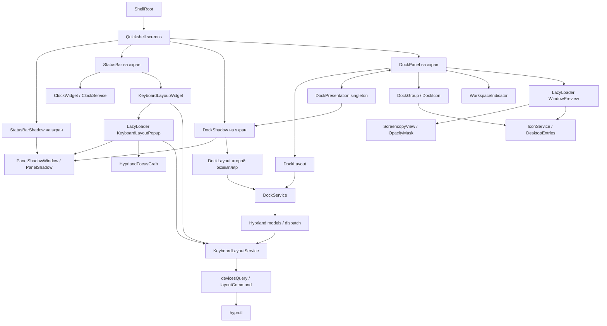
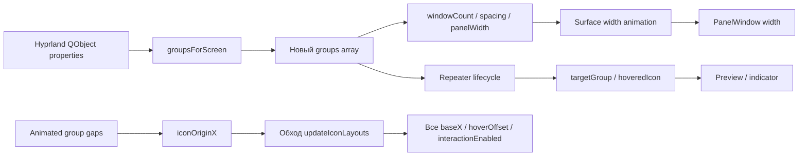
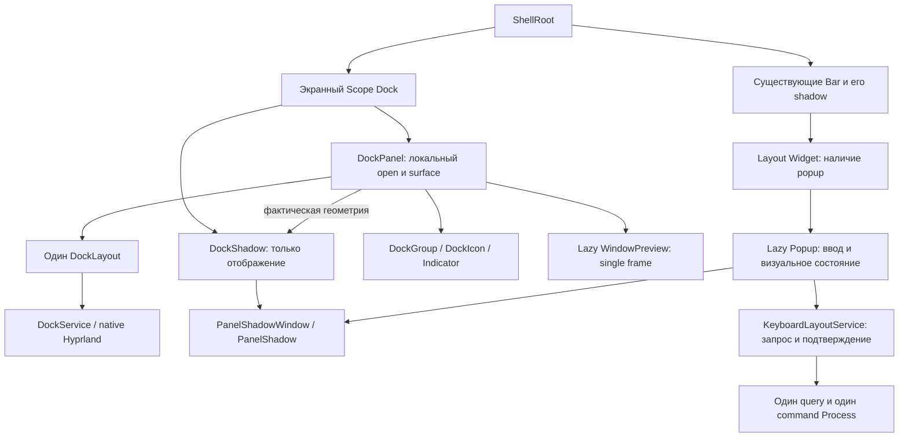
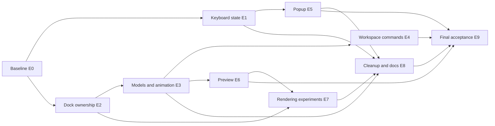

# Aerix: аудит QML-архитектуры и план постепенного рефакторинга

Дата: 2026-11-08. Статус: **исследование завершено; выполнен E0 с ограничениями измерений; E1 не начат**.
Срез исходников: Git `075842e20fdab4d996921b0f841f0e5a145cebfd`, чистое рабочее
дерево перед аудитом. Документ подготовлен рядом с
[планом Bar и обзора](Bar_and_workspace_overview_plan.md), с сохранением его
подхода: небольшие этапы, зависимости, проверяемая приёмка и журнал выполнения.

## Как выполнять этот документ

Это план будущих работ, а не разрешение на их выполнение. Во время аудита
создан только этот Markdown-файл. Исходники, зависимости и конфигурация
Hyprland не менялись; оболочка не перезапускалась, диагностические интерфейсы
в неё не добавлялись. Команды и сценарии ниже, кроме явно отмеченных выполненных
проверок, предназначены **для будущей реализации и измерений**.

Перед отдельным заданием перечитать [Project_manual.md](Project_manual.md),
[Project_rules.md](Project_rules.md) и актуальный код. Номера строк относятся
к этому срезу и после изменений должны перепроверяться. Сохранять чужие изменения.
Не выполнять весь план одним большим изменением. Для гипотез сначала получить
измерение; отрицательный результат исследования — основание закрыть пункт
без изменения реализации.

Не добавлять polling, таймеры упорядочивания bindings, универсальный event bus,
менеджер всех popup, новый daemon или C++/Rust-backend без отдельной доказанной
необходимости. Сохранять все согласованные жесты, анимации, прозрачность и внешние
тени. Изменение UX оформлять отдельно от рефакторинга.

## 1. Executive Summary

Проект существенно компактнее, чем предполагает исходная гипотеза:
**23 QML-файла, 1 925 строк**, включая комментарии и пустые строки. Отдельных
JavaScript-модулей, собственных шейдеров, сборочного backend или реализации
workspace overview в текущем дереве нет. Переписывание Shell с нуля не оправданно.

Основы уже выбраны правильно: один процесс, системные модели Hyprland,
общие источники времени и раскладки, ограниченный кэш иконок, ленивые окна,
общий компонент тени, события вместо опроса. В исходниках нет периодического
`hyprctl`, бесконечных анимаций или доказанной утечки памяти. Два экземпляра
`Process` означают два объекта управления командами, а не два постоянно
работающих дочерних процесса.

Основной долг сосредоточен в трёх местах:

1. **Согласованность системного состояния.** Запрос раскладки, пришедший во
   время другого запроса, теряется; завершение процесса смешано с подтверждением
   выбора; одинаковый список layouts публикуется заново.
2. **Владение геометрией и делегатами Dock.** Тень повторно вычисляет модель и
   независимо анимирует размеры; её окно сразу получает целевую ширину, тогда
   как окно Dock следует промежуточной ширине. Новые массивы групп связаны с
   риском пересоздания делегатов и потери ссылки на активную группу.
3. **Границы popup/capture/rendering.** Ввод через focus grab конфликтует с
   повторным кликом по триггеру; запас поверхности не покрывает новое движение
   popup; snapshot вручную получается через временный live-захват. Стоимость
   масок и HyprGlass необходимо отделить от стоимости QML.

В реестре **23 пункта: P0 — 0, P1 — 6, P2 — 13, P3 — 4**. Это не 23
воспроизведённых ошибки: реестр включает подтверждённый долг, вероятные дефекты,
гипотезы производительности и согласованный временный тестовый режим.
Оснований объявлять постоянную критическую нагрузку или ставить P0 нет.

Наиболее перспективны: один расчёт Dock на экран; одна фактическая анимированная
геометрия Dock/тени; сохранение идентичности моделей там, где состав не изменился;
гарантированная повторная синхронизация раскладки; штатный одиночный capture.
Процент ускорения, экономия RAM и количество устранённых GPU passes **не измерены**.

## 2. Область и полнота аудита

### 2.1. Полная инвентаризация QML

Все перечисленные файлы прочитаны полностью, включая небольшие адаптеры.
Обнаружение выполнялось по файловой системе, а не только по Git index; скрытых
дополнительных QML/JS-файлов в проекте не найдено.

| Файл | Строк | Ответственность и фактическое использование |
| --- | ---: | --- |
| [shell.qml](../shell.qml) | 27 | ShellRoot, четыре экранных Variants |
| [Metrics.qml](../core/Metrics.qml) | 46 | Общие размеры, цвета, радиусы |
| [Motion.qml](../core/Motion.qml) | 15 | 512/768 мс, задержка 1128 мс, bezier |
| [StandardAnimation.qml](../core/StandardAnimation.qml) | 10 | Общая NumberAnimation |
| [PanelShadow.qml](../core/PanelShadow.qml) | 66 | RectangularShadow и вырез через OpacityMask |
| [PanelShadowWindow.qml](../core/PanelShadowWindow.qml) | 37 | Input-прозрачное окно общей тени |
| [StatusBar.qml](../bar/StatusBar.qml) | 76 | Заливка Bar, reserved area, три зоны |
| [StatusBarShadow.qml](../bar/StatusBarShadow.qml) | 32 | Геометрия верхней тени |
| [ClockWidget.qml](../bar/ClockWidget.qml) | 13 | Отображение общего времени |
| [KeyboardLayoutWidget.qml](../bar/KeyboardLayoutWidget.qml) | 74 | EN/RU, Font Awesome, владелец LazyLoader |
| [KeyboardLayoutPopup.qml](../bar/KeyboardLayoutPopup.qml) | 301 | Overlay, grab, список, анимация, отдельная тень |
| [DockLayout.qml](../dock/DockLayout.qml) | 25 | Группы, активный workspace, шаг и ширина |
| [DockPanel.qml](../dock/DockPanel.qml) | 258 | Surface, input mask, hover, scroll, preview |
| [DockShadow.qml](../dock/DockShadow.qml) | 49 | Вторая геометрия/анимация Dock |
| [DockGroup.qml](../dock/DockGroup.qml) | 141 | Workspace spacing, hover expansion, Repeater иконок |
| [DockIcon.qml](../dock/DockIcon.qml) | 109 | Иконка, fallback, локальные жесты и анимации |
| [WorkspaceIndicator.qml](../dock/WorkspaceIndicator.qml) | 98 | Перемещение, расширение и nudge капсулы |
| [WindowPreview.qml](../dock/WindowPreview.qml) | 182 | PopupWindow, снимок окна, title, маска |
| [DockService.qml](../services/DockService.qml) | 96 | Группировка, фокус, переход workspace |
| [DockPresentation.qml](../services/DockPresentation.qml) | 36 | Глобальные карты открытия/ширины по экрану |
| [IconService.qml](../services/IconService.qml) | 69 | DesktopEntries, разрешение и кэш иконок |
| [ClockService.qml](../services/ClockService.qml) | 13 | Один SystemClock.Minutes |
| [KeyboardLayoutService.qml](../services/KeyboardLayoutService.qml) | 152 | Devices query, выбор раскладки, rawEvent |

Прочитаны оба `qmldir`, `.qmlls.ini`, `.gitignore`, `media/README.md`, документы
архитектуры, теней, Bar, исторических измерений и план-пример. Встроенный JS
находится в QML. `media/icons/` содержит только `.gitkeep`.
Служебные настройки агентов с потенциальными секретами не являются исходниками
Shell и не включались в содержательный аудит.

### 2.2. Проверенные внешние зависимости

- Локальные пакеты: Quickshell **0.3.2-1**, Qt Base **6.12.0-3**,
  Qt Declarative **6.12.0-4**, Qt5Compat **6.12.0-1**, Hyprland **0.57.0-3**.
  Это версии установленных пакетов, а не доказательство версии уже запущенных
  бинарников. Отдельный runtime-запрос версии не дал результата.
- Изучены локальные метаданные Quickshell, включая внутренние модули
  `_Screencopy`, `_FocusGrab`, `_Ipc`, а также `Process`, `Region`, `LazyLoader`,
  `Scope`, Repeater. Публичный `Quickshell.Wayland` реэкспортирует подмодули:
  поиск только в его основном `.qmltypes` пропускает нужные типы.
- Изучена установленная реализация
  `/usr/lib/qt6/qml/Qt5Compat/GraphicalEffects/OpacityMask.qml`: два SourceProxy,
  ShaderEffect, опциональный cacheItem; `cached` по умолчанию false.
- Только прочитаны локальные `~/.config/hypr/plugins/hyprglass.lua`,
  `animations.lua`, `decorations.lua`. Они находятся вне репозитория; наличие
  файла не доказывает загрузку плагина и фактическое применение каждого параметра.
- Проверены первичные документы Qt/Quickshell/Hyprland; ссылки приведены рядом
  с соответствующими выводами. Онлайн-документация Quickshell v0.3.0 сверена
  с установленными qmltypes 0.3.2, но не заменяет проверку реализации backend.

### 2.3. Что действительно выполнено

| Проверка | Результат | Граница доказательства |
| --- | --- | --- |
| Полный проход по QML | 23/23, 1 925 строк | Статический анализ, не визуальная приёмка |
| Поиск ссылок/динамической загрузки | Все 22 компонента, кроме точки входа, имеют потребителей | Внутренние callbacks проверены отдельно; простой поиск не доказывает ненужность QObject |
| `qmllint` всех 23 файлов | Exit 0, 23 предупреждения | Exit 0 не означает отсутствие проблем |
| `hyprctl -j layers` | На DP-2 четыре слоя Aerix одного PID 466223 | Снимок состояния, не число внутренних QML/GPU-объектов |
| `quickshell log -t 24` | Есть Configuration Loaded и Wayland textinput warnings | Исторический хвост; причина warnings не локализована |
| Проверка `/proc`/списка процессов | PID оболочки из layers в доступном `/proc` отсутствует | CPU/RSS/PSS текущей оболочки не измерены |
| Последующие `hyprctl -j monitors/version` | `Couldn't set socket timeout (2)` | Текущие refresh rate, GPU и версия runtime не зафиксированы |

Предупреждения lint: 3 uncreatable PanelWindow, 5 singleton/import,
14 missing-property, 1 onAnchoring/unqualified. Часть согласуется с неполными
метаданными и способом запуска lint: типы реально используются в загруженных
окнах, singleton зарегистрированы в `qmldir`. Это не повод отключить категории
целиком; будущая проверка должна воспроизводить import paths Quickshell и
отделять новые предупреждения от baseline.

Не проводились: запись GPU/CPU trace, захват кадров, искусственные клики,
переключение workspace/раскладок, hotplug, отключение HyprGlass, перезапуск Shell,
изменение режимов мониторов, установка профилировщиков. Исторические числа из
[Perfomance.md](Perfomance.md) не являются результатами этого аудита.

## 3. Текущая архитектура и потоки данных

### 3.1. Компоненты и владельцы



Пять singleton-сервисов плюс Metrics/Motion общие для процесса. Импорт singleton
не означает отдельный процесс и не обязательно немедленную инициализацию.
Количество экранных UI растёт с `Quickshell.screens`; состояние клавиатуры,
часов и кэш иконок не дублируются на мониторах.

### 3.2. Основные пути обновления

| Триггер | Цепочка | Жизненный цикл / важная граница |
| --- | --- | --- |
| Открытие/закрытие/перенос окна | Hyprland models → DockService → оба DockLayout → массивы groups → Repeater | QObject окна остаются системными; JS-обёртки групп новые |
| Смена активного workspace | monitor.activeWorkspace → activeWorkspaceKey → групповые padding/gaps и targetGroup | Выбор по данным, а не по порядку изменения isActiveWorkspace делегатов |
| Hover Dock | HoverHandler → DockPresentation.openByScreen → две анимации y | Маска ввода и restoreHover зависят от фактической позиции Dock |
| Hover иконки | MouseArea → hoveredAddress → hoveredIndex → updateIconLayouts → hoveredIcon | Preview живёт по ссылке на делегат; быстрый выход уничтожает его |
| Клик окна | DockService.focusWindow → Wayland activate или Hyprland.dispatch | Проверка адреса есть; fallback учитывает usingLua |
| Колесо | wheelDelta → цикл порога 120 → switchWorkspace | Каждый шаг заново читает подтверждённый activeWorkspace |
| Изменение раскладки | rawEvent/open popup → dirty refresh → Process → JSON → device/layouts/index | Hotplug без отдельного IPC event обновляется при следующем открытии |
| Выбор строки | popup request token → service intent → command exit → fresh query → один result signal | Старый query не подтверждает новую команду; закрывается только инициатор |
| Открытие/закрытие popup | popupOpen → LazyLoader → expanded/reveal/y → dismissed → unload | Наличие объекта и цель анимации — разные состояния, их нельзя просто слить |
| Время | SystemClock.Minutes → timeText → ClockWidget всех Bar | Один источник; нет секундного обновления |
| Изменение desktop entries | applicationsChanged → новый Map → iconSource bindings | Кэш ограничен 256 записями |

### 3.3. Что следует сохранить

- `DockService` — небольшой адаптер данных и команд, не «god object».
- `DockGroup`/`DockIcon`/`WorkspaceIndicator` уже разделяют обязанности разумно.
- `ClockWidget` и `ClockService` просты; объединять их ради удаления файла не нужно.
- Общие `PanelShadowWindow` и `PanelShadow` уже устраняют крупное дублирование.
- Рамка активной раскладки отделена от hover opacity; это необходимая композиция.
- `ListView` раскладок виртуализирует строки. 32 тестовые записи не равны 32
  постоянно созданным делегатам; есть viewport, cache и current item.
- Наличие `popupOpen` и `expanded` оправданно анимацией закрытия: объект должен
  дожить до её конца. Это не само по себе дублирование состояния.

## 4. Основные системные проблемы

| Первопричина | Проявления | Пункты реестра |
| --- | --- | --- |
| Нет чёткой границы «запрос → свежий снимок → подтверждение» | Потерянный refresh, раннее снятие busy, устаревшее устройство | F01–F04 |
| Несколько владельцев одной экранной геометрии | Рассогласованная ширина тени, повторная группировка, глобальные карты UI | F05–F06 |
| Снимок данных смешан с идентичностью визуальных объектов | Пересоздание Repeater, targetGroup/hoveredIcon, каскады геометрии | F07–F10 |
| Не определены крайние системные сценарии | Special/unknown monitor, пачка wheel dispatch | F11–F12 |
| Протокольный lifecycle не полностью выражен в UI | Ручной live snapshot, anchor, focus grab и повторный клик | F13–F15 |
| Новые эффекты добавляются без проверки полных bounds | Обрезание анимируемого окна, неопределённая цена масок | F16, F19 |
| Не отделены тестовый режим и актуальный контракт | Navigation feedback, тестовые строки, устаревшие документы | F17–F18, F22 |

Ни одного подтверждённого binding loop не найдено. Не найдено большого количества
дублирующих `Connections`: два общих и один на открытый popup. Горячий путь —
вычисления геометрии во время движений и замена моделей, а не число подписок само
по себе. Две похожие проверки подтверждения выбора отражают два порядка событий;
удалять одну до нормализации lifecycle нельзя.

## 5. Каталог технического долга и рисков

Обозначения: **К — подтверждено кодом**, **В — вероятно**, **Г — гипотеза**.
Подтверждение структуры кода не подтверждает величину её стоимости. В каждом
пункте отдельно указана проверка; приоритет гипотезы означает приоритет
исследования, а не обязательную замену реализации.

### F01. Потеря запроса обновления раскладки — P1, К

- **Где:** [KeyboardLayoutService.qml](../services/KeyboardLayoutService.qml),
  `refresh`, строки 87–91; обработчики 134–147.
- **Сейчас:** если devicesQuery.running, refresh ничего не делает. Ни dirty-флага,
  ни последующего чтения после завершения нет.
- **Причина/последствие:** событие B может прийти после получения снимка A, но
  до его onExited. B теряется; публикуется A, и UI остаётся устаревшим до нового
  внешнего события. Это достижимая последовательность, не доказанная частота.
- **Решение:** в существующем сервисе один флаг необходимости обновления;
  запрос во время работы устанавливает его, завершение запускает максимум одно
  дополнительное чтение. Сбрасывать флаг в момент старта нового чтения, чтобы
  новое событие во время него снова учитывалось. Не параллелить процессы.
- **Обоснование:** сохраняется последняя инвалидизация при ограниченном числе
  процессов, без debounce Timer и постоянного polling.
- **Риск:** неправильный порядок сброса создаст потерю события или бесконечную
  цепочку. Ошибка команды не должна сама повторно ставить refresh без ограничения.
- **Проверка:** сценарии A/B/C в промежутках start/read/exit; при пачке событий
  во время одного query появляется один последующий query. После затишья состояние
  совпадает с последним ответом, процессов и отложенных запросов нет.

### F02. Завершение команды не равно подтверждённому выбору — P1, В

- **Где:** [KeyboardLayoutService.qml](../services/KeyboardLayoutService.qml),
  38, 94–109, 129–139; [KeyboardLayoutPopup.qml](../bar/KeyboardLayoutPopup.qml),
  18, 76–88, 106–119, 276–277.
- **Сейчас:** commandPending отражает только `layoutCommand.running`. UI хранит
  только pendingIndex; после exit повторный выбор разрешён, хотя query ещё
  может не подтвердить новый layout. Выбранное устройство не входит в intent UI.
- **Причина/последствие:** модель подтверждения распределена между сервисом и
  popup. Возможны повторная команда по старому activeIndex, закрытие по ответу
  другого поколения данных, неоднозначность при смене main-клавиатуры.
- **Решение:** сервис владеет одним незавершённым выбором `{deviceName, index}`
  и фазой выполнения/сверки; выставляет busy до успешного свежего подтверждения
  или явного отказа. Событие результата относится к этой операции. Popup только
  закрывается на успех своего выбора; его уничтожение не отменяет сверку сервиса.
- **Обоснование:** один контракт завершения вместо двух UI-проверок порядка
  сигналов. Не нужен глобальный request manager или очередь произвольных команд.
- **Риск:** бесконечный busy при отсутствии подтверждения. После успешного exit
  обязательна свежая сверка; несовпадение, исчезнувшее устройство и ошибка должны
  завершать попытку отказом. Timeout вводить только при доказанно зависающем
  backend, как ограничение операции, а не лечение порядка bindings.
- **Проверка:** event до/после exit, отказ процесса, внешняя смена во время выбора,
  закрытие UI до результата, два Bar, три быстрых выбора. Один intent не завершается
  данными, полученными до его исполнения. Зависит от F01.

### F03. Новый список layouts публикуется при каждом ответе — P2, К

- **Где:** [KeyboardLayoutService.qml](../services/KeyboardLayoutService.qml),
  68–83; [KeyboardLayoutPopup.qml](../bar/KeyboardLayoutPopup.qml), 22–25, 197–198.
- **Сейчас:** `codes.map` и `layouts = nextLayouts` выполняются даже если поменялся
  только activeIndex. Popup заново делает concat и создаёт 32 тестовых объекта.
- **Причина/последствие:** структура списка и текущее значение не разделены по
  частоте. Новая ссылка инвалидирует model; сохранение scroll/current/delegates
  не гарантировано. Число реальных пересозданий требует runtime-проверки.
- **Решение:** сравнивать малый упорядоченный список по layout/variant/index;
  публиковать новую структуру только при изменении устройства или состава.
  activeIndex обновлять отдельно. Тестовую модель создавать только в тестовом режиме.
- **Обоснование:** O(L) сравнение на системное событие дешевле и проще, чем
  перестройка UI; persistent cache и hash-подсистема не нужны.
- **Риск:** сравнение только по двухбуквенной подписи объединит разные variants.
- **Проверка:** внешние переключения с открытым списком не меняют count/scroll
  и идентичность неизменных строк; изменение variants действительно обновляет модель.

### F04. Граница devices JSON, ошибок и обновления устройства неполна — P2, К/В

- **Где:** [KeyboardLayoutService.qml](../services/KeyboardLayoutService.qml),
  51–85, 121–125, 142–151; [KeyboardLayoutWidget.qml](../bar/KeyboardLayoutWidget.qml),
  55–59.
- **Сейчас:** ловится только ошибка JSON.parse; валидный JSON `null` затем падает
  на `devices.keyboards`. `Number(null)` превращается в 0. Query failure при ранее
  available состоянии не сообщает об ошибке. Обновление слушает только два события;
  открытие меню не выполняет проверку устройства.
- **Причина/последствие:** синтаксический успех принят за корректный контракт;
  hotplug без activelayout/configreloaded может оставить устаревшую main-клавиатуру.
  Ошибки схемы следуют из кода; фактические события hotplug требуют проверки версии.
- **Решение:** проверять корень/keyboard/index до публикации; определять состояние
  stale/error отдельно от сохранённого последнего успешного отображения. Использовать
  реальные события устройств, если они доступны, иначе событийное чтение при
  открытии меню и переоценку цели перед командой. Не выдумывать keyboardadded IPC:
  опубликованный список событий не гарантирует его наличие.
- **Обоснование:** ограниченная проверка внешней границы без собственного парсера
  XKB и без фонового polling. Если hotplug в закрытом UI не наблюдаем, честно
  документировать задержку обновления до следующего доступного события.
- **Риск:** скрыть все layouts при временном сбое или направить выбор нового
  списка по старому индексу. Intent из F02 должен фиксировать устройство/состав.
- **Проверка:** пустой/null/повреждённый ответ, отсутствующий и null index,
  несколько клавиатур, смена main, отказ query после успешного старта. Не удалять
  реальные устройства ради теста ошибок; использовать будущие контролируемые fixtures.

### F05. Окно тени получает целевую ширину раньше Dock — P1, К

- **Где:** [DockPanel.qml](../dock/DockPanel.qml), 31–32, 46, 127–141;
  [DockShadow.qml](../dock/DockShadow.qml), 19–20, 28, 32–47.
- **Сейчас:** окно панели имеет ширину `ceil(panelSurface.width) + 2*margin`,
  где panelSurface.width анимируется. Окно тени использует сразу конечный
  panelWidth, а внутренний shadowSurface.width анимируется отдельно.
- **Причина/последствие:** оба окна центрированы на экране, но их origins во время
  resize различны. При текущих равных боковых margin ошибка левого края тени
  равна примерно `(w(t) − W)/2`, где W — цель, w(t) — промежуточная ширина.
  Например, 200 → 300 даёт около −50 логических px в начале. Это расчёт по коду,
  не измеренный скриншот; округление может добавить долю пикселя.
- **Решение:** тень получает фактические размеры/позицию поверхности Dock и
  согласованные экранные координаты окна. У неё нет самостоятельного Behavior
  на ту же геометрию. Разный запас теневого окна компенсировать явным origin.
- **Обоснование:** одна траектория гарантирует совпадение лучше, чем одинаковые
  параметры двух независимых анимаций. У popup уже используется такой принцип.
- **Риск:** неверный перевод между локальными координатами двух окон,
  обрезание тени, смена stacking при перестройке владельца.
- **Проверка:** рост/сжатие ширины и обратная смена цели в середине движения,
  пустая модель, предел 75%, DPR 1/1.25/2. Сравнивать экранные границы в каждом
  кадре, а не только конечные значения. Сохранять 768 мс и существующую кривую.

### F06. Двойной DockLayout и глобальный мост экранного UI — P2, К

- **Где:** [DockPanel.qml](../dock/DockPanel.qml), 17–32;
  [DockShadow.qml](../dock/DockShadow.qml), 15–25;
  [DockPresentation.qml](../services/DockPresentation.qml), 7–34;
  [shell.qml](../shell.qml), 18–25.
- **Сейчас:** на экран создаются два DockLayout. Даже fallback-аргумент
  `layout.panelWidth` вычисляется до вызова widthFor; наличие cached width
  не устраняет второй binding groups. Карты singleton копируются через Object.assign.
  Записи отключённых экранов не удаляются.
- **Причина/последствие:** shadow одновременно потребитель геометрии и второй
  владелец модели. Изменение карты одного монитора инвалидирует читателей всей
  карты. Старое open-состояние может пережить отключение экрана. Это маленькое
  удержание данных, не доказанная крупная утечка.
- **Решение:** локально связать пару DockPanel/DockShadow на экране; оставить
  один DockLayout и владельца открытия в DockPanel. После переключения потребителей
  удалить DockPresentation и его регистрацию. Пример целевой композиции — §11.
- **Обоснование:** устраняется целый класс синхронизации без нового singleton.
- **Риск:** создание shadow до готовности screen/source, порядок окон и hot reload.
- **Проверка:** один расчёт модели на экран, отсутствие глобальных screen-карт,
  отключение/повторное подключение экрана, reload. Делать вместе с контрактом F05,
  но отдельным проверяемым шагом.

### F07. Новые снимки групп могут пересоздавать весь Dock — P1, В

- **Где:** [DockService.qml](../services/DockService.qml), 21–46;
  [DockLayout.qml](../dock/DockLayout.qml), 10;
  [DockPanel.qml](../dock/DockPanel.qml), 223–235;
  [DockGroup.qml](../dock/DockGroup.qml), 116–139.
- **Сейчас:** каждый пересчёт создаёт новые group objects, windows arrays и
  результирующий массив. Оба Repeater используют JS-модели без стабильного
  инкрементального контракта. `key` в объекте сам по себе не делает Repeater keyed.
- **Причина/последствие:** изменение одного окна, включая другого монитора,
  способно пересоздать неизменные группы и иконки. Вероятны сброс анимации,
  разрушение hover/preview и повторная подготовка Image; объём churn не измерен.
- **Решение:** после F06 измерить itemAdded/itemRemoved и время на типовых
  изменениях. Сначала не публиковать новый снимок при неизменных упорядоченных
  ключах и ссылках на окна; сохранять неизменные вложенные windows arrays.
  Если реальное структурное изменение всё ещё разрушает все группы и это
  заметно, применять небольшую локальную инкрементальную модель, см. §12 E3.
- **Обоснование:** исправлять нестабильность идентичности, не строить вторую
  базу данных Hyprland. Map-группировка O(N + G log G) уже хороша.
- **Риск:** новая модель может забыть rename/move/monitorChanged, retain stale
  QObject или переставить окна. Нельзя сравнивать только адрес: адрес может
  повторно использоваться после закрытия окна.
- **Проверка:** закрытие одного из нескольких окон той же группы, перенос между
  существующими группами, изменение другого монитора, нулевой/тот же groupCount.
  У неизменных делегатов сохраняется identity; оконные данные остаются актуальными.

### F08. Полный императивный обход иконок на каждом изменении origin — P2, К

- **Где:** [DockGroup.qml](../dock/DockGroup.qml), 29, 46–66, 87–114.
- **Сейчас:** animated workspacePadding/leftWorkspaceGap/leftHoverExpansion
  меняют iconOriginX. Каждый onIconOriginXChanged обходит все иконки группы и
  присваивает сразу interactionEnabled, hoverOffset и baseX.
- **Причина/последствие:** O(n группы) JS-работы на анимационный шаг; большая
  часть присваиваемых значений при движении origin не меняется. Qt может подавить
  равные notify, но сам JS-обход и вычисления выполняются.
- **Решение:** сначала профиль после стабилизации F07/F09. Общую translation
  группы вынести в один визуальный transform/контейнер; индивидуальные x считать
  от index*spacing и hoverOffset. Либо узкие декларативные bindings с устойчивым
  owner, если они проходят уничтожение делегатов. Выбрать один подход по trace.
- **Обоснование:** уменьшить работу на кадр, а не просто заменить JS множеством
  равнозначных bindings. Дополнительный контейнер оправдан только общей translation.
- **Риск:** возврат старых ошибок чтения уничтоженного родителя, изменение
  hitbox, hoverExpansion и индикатора. Нынешняя явная передача появилась по причине;
  нельзя удалить её без сценариев жизненного цикла.
- **Проверка:** число вызовов/присваиваний и GUI-thread время при 10/50/100 окнах,
  два направления hover, закрытие окна во время анимации, отсутствие новых warnings.

### F09. Ссылка активного индикатора зависит от count, не от готовности item — P1, В

- **Где:** [DockPanel.qml](../dock/DockPanel.qml), 198–209, 223–225;
  [WorkspaceIndicator.qml](../dock/WorkspaceIndicator.qml), 9–45.
- **Сейчас:** targetGroup читает model, count и itemAt. Для groupRepeater нет
  itemAdded/itemRemoved-синхронизации, в отличие от внутреннего iconRepeater.
- **Причина/последствие:** при замене модели с тем же count или уничтожении
  группы возможен промежуточный null без надёжного последующего обновления.
  Это согласуется с риском потери капсулы, но существующая регрессия в сессии
  не воспроизводилась. Qt прямо различает count и число созданных delegates:
  [Repeater](https://doc.qt.io/qt-6/qml-qtquick-repeater.html#count-prop).
- **Решение:** active key продолжать выбирать из данных. Обновление визуальной
  ссылки привязать к itemAdded/itemRemoved и изменениям ключа/модели одним
  небольшим механизмом; не искать активность по последовательно меняющимся
  isActiveWorkspace. Стабильная модель F07 уменьшает число таких переходов.
- **Обоснование:** явная готовность объекта вместо предположения о порядке binding.
- **Риск:** на itemRemoved нельзя повторно сохранить уходящий объект; локальная
  синхронизация не должна запустить множество рестартов индикатора.
- **Проверка:** заменить группу при том же числе групп и активном ключе;
  убрать последнее окно, вернуть первое, переключить оба направления. Никаких
  `Timer`, отложенных повторных поисков и вечного revision-counter для сокрытия гонки.

### F10. Прерывание движения индикатора не всегда сохраняет фактическую базу — P2, К

- **Где:** [WorkspaceIndicator.qml](../dock/WorkspaceIndicator.qml), 20–21,
  35–49, 64–85.
- **Сейчас:** slideStartX сохраняет x, уже включающий nudgeOffset, затем x снова
  прибавляет nudgeOffset. При переходе во время nudge он кратковременно учитывается
  дважды. verticalExpansion каждого нового перехода принудительно стартует от 0.
- **Причина/последствие:** состояние основной траектории смешано с добавочным
  эффектом; быстрые переходы могут дать скачок даже при корректной обычной прокрутке.
- **Решение:** при snapshot позиции отделять base от nudge, явно решить отмену
  или продолжение nudge; verticalExpansion продолжать от фактического значения.
  Не менять обычную фирменную траекторию и длительности.
- **Обоснование:** прерываемая анимация должна начинаться с того, что видно сейчас.
- **Риск:** потеря обратной связи на краю списка или изменение обычного расширения.
- **Проверка:** край → nudge → внешний переход workspace на середине nudge;
  быстрые переключения во время обеих фаз verticalExpansion, в обе стороны.

### F11. Политика unknown monitor и special workspace не выражена — P2, К/В

- **Где:** [DockService.qml](../services/DockService.qml), 25–30, 72–93;
  [DockLayout.qml](../dock/DockLayout.qml), 11–12.
- **Сейчас:** окно без monitor и workspace.monitor допускается на каждый экран.
  Колесо сортирует все workspaces монитора по ID и отправляет ID строкой;
  special/именованные не отделены. Активная группа выбирается по name.
- **Причина/последствие:** переходные данные дают дублирование окон на мониторах;
  специальные рабочие пространства могут попадать в обычную последовательность.
  Корректность dispatch конкретного ID зависит от версии Hyprland/Lua.
- **Решение:** зафиксировать политику до изменения: unknown ownership — временно
  не выводить на всех экранах либо сохранить последнего подтверждённого владельца
  только если это необходимо; обычное колесо не должно случайно открывать special.
  Использовать поддерживаемый способ активации установленной версии, не
  заменять selectors по догадке. Сохранить существующую работу именованных workspace.
- **Обоснование:** отсутствие monitor не является доказательством принадлежности всем.
- **Риск:** временно скрытые окна при startup/hotplug, потеря доступа к special,
  несовместимость Lua/non-Lua. Это контрактная задача, не безусловный Quick Win.
- **Проверка:** named/special/pinned, монитор исчезает во время переноса,
  workspace без окон, одинаковый набор данных на двух экранах; проверка API версии.

### F12. Пачка wheel-шагов читает одну устаревшую позицию — P2, В

- **Где:** [DockPanel.qml](../dock/DockPanel.qml), 177–193;
  [DockService.qml](../services/DockService.qml), 73–93.
- **Сейчас:** событие angleDelta 240 приводит к двум синхронным вызовам
  switchWorkspace; каждый читает activeWorkspace и посылает асинхронную команду.
- **Причина/последствие:** до прихода нового состояния оба вызова могут выбрать
  одного соседа. Лишний dispatch не обеспечивает два перехода; цена растёт с
  пачкой, а правило обработки high-resolution touchpad не зафиксировано.
- **Решение:** считать число целых шагов события и одну целевую позицию, отправлять
  одну команду. Если разные события тоже приходят быстрее подтверждения,
  отдельно проверить необходимость короткого pending intent до подтверждения;
  не вводить универсальную очередь заранее. Остаток wheelDelta хранить осознанно.
- **Обоснование:** одна цель на жестовую порцию, без sleep/Timer throttle.
- **Риск:** изменение привычной скорости колеса и поведения на границе списка.
- **Проверка:** ±60, ±120, ±240, разворот знака, серия touchpad-событий,
  достижение края; число команд соответствует выбранному контракту.

### F13. Snapshot реализован временным live-режимом без обработки stopped — P2, В

- **Где:** [WindowPreview.qml](../dock/WindowPreview.qml), 105–131.
- **Сейчас:** смена captureSource включает live, первый hasContent выключает.
  `captureFrame()` и `stopped` не используются; при отсутствии кадра нет явного
  fallback-состояния. Закрытие LazyLoader освобождает объект, что уже правильно.
- **Причина/последствие:** получение одного кадра выражено дополнительной
  машиной состояний; остановка/смена источника зависит от порядка hasContent.
  Непрерывный capture в текущей сессии не доказан.
- **Решение:** проверить штатный `captureFrame()` при `live: false` для первого
  источника и смены A → B, использовать его при эквивалентном результате;
  обработать stopped/null/no-content лёгким title/icon fallback без бесконечного retry.
- **Обоснование:** API для одного кадра присутствует локально и документирован:
  [ScreencopyView](https://quickshell.org/docs/v0.3.0/types/Quickshell.Wayland/ScreencopyView/).
  `constraintSize` ограничивает implicit size, не обещает меньший capture buffer.
- **Риск:** захват до готовности surface/backend, потеря нового кадра при повторном
  источнике, недоступные inactive/fullscreen/XWayland-окна.
- **Проверка:** движущееся содержимое после первого кадра не обновляет preview;
  A → B без выхода из Dock даёт B; закрытие окна/отказ экспорта не создают поток.
  После unload нет живого ScreencopyView. Не добавлять кэш всех снимков.

### F14. Preview anchor не подписан на всё движение иконки — P2, В

- **Где:** [WindowPreview.qml](../dock/WindowPreview.qml), 42–51, 63–67;
  [DockPanel.qml](../dock/DockPanel.qml), 163–173, 213–220.
- **Сейчас:** mapToItem вызывается при anchoring, updateAnchor — при смене
  iconItem. Движение того же делегата из-за hover/layout/Flickable.contentX
  не имеет явной связи с вызовом updateAnchor.
- **Причина/последствие:** preview может остаться по старому центру. Автоматические
  переякоривания backend могут частично скрывать проблему; это проверить.
- **Решение:** определить контракт: следовать иконке либо закрепляться один раз
  после hover-layout. Для текущего требования центрирования подписать необходимые
  координаты/scroll активного якоря только на время preview; не на все иконки.
- **Обоснование:** адресная зависимость вместо постоянного polling координат.
- **Риск:** reanchor каждый кадр способен увеличить протокольную работу или
  перезапускать размещение; ограничение окна у края должно сохраниться.
- **Проверка:** длинный Dock, прокрутка с тем же hoveredIcon, рост ширины,
  hoverExpansion, смена DPI; сопоставить anchor rect и экранный центр иконки.

  **Статус 2026-11-08:** кодовый контракт реализован в E6.3: пока создан
  единственный `WindowPreview`, он повторно вызывает `anchor.updateAnchor()`
  только при изменении геометрии `DockIcon`, его `DockGroup`, `Row`,
  `Flickable.contentItem`, высоты панели либо размера самой карточки. Ни
  `ScreencopyView`, ни запросы IPC к этому пути не подключены. Проверка
  compositor adjustment у границ экрана и частоты reanchor при настоящем
  scroll остаётся ручной приёмкой E9; ускорение от этой коррекции не заявляется.

### F15. Триггер popup не включён в grab и конкурирует с dismiss — P1, В

- **Где:** [KeyboardLayoutPopup.qml](../bar/KeyboardLayoutPopup.qml), 73–74,
  98–104; [KeyboardLayoutWidget.qml](../bar/KeyboardLayoutWidget.qml), 55–59.
- **Сейчас:** grab разрешает только popup. Клик по EN/RU относится к внешнему
  окну Bar: grab инициирует dismiss, а widget при существующем объекте вызывает
  toggle, способный снова раскрыть только что закрываемое окно.
- **Причина/последствие:** результат зависит от доставки/подавления клика и
  очередности событий compositor/Qt. Это вероятное объяснение прежней
  «неотзывчивости», не доказанный диагноз textinput warnings.
- **Решение:** протокольно согласовать триггер и внешнее закрытие. Первым проверить
  whitelist `[popup, barWindow]` с явным закрытием при клике по остальному Bar;
  оно не должно поглощать будущие действия других виджетов. При неприемлемой
  семантике использовать единый обработчик жеста открытия/закрытия с явной целью,
  проверенный на установленном focus-grab backend. Не вводить timeout подавления клика.
- **Обоснование:** внешняя документация подтверждает cleared при клике вне
  windows, но не гарантирует порядок click-through:
  [HyprlandFocusGrab](https://quickshell.org/docs/v0.3.0/types/Quickshell.Hyprland/HyprlandFocusGrab/).
- **Риск:** whitelist всего Bar сам по себе нарушает требование закрытия при
  клике в любом другом месте. Требуется обработка внутри Bar и проверка второго
  монитора; новый полноэкранный input-layer не является первым решением.
- **Проверка:** клик EN/RU по открытому/открывающемуся/закрывающемуся меню,
  пустое место Bar, часы, приложение, Dock, другой монитор, Escape. Один жест
  приводит к одной конечной цели, после закрытия ввод возвращён приложению.

### F16. Запас popup не покрывает всю анимацию и высоту экрана — P2, К

- **Где:** [KeyboardLayoutPopup.qml](../bar/KeyboardLayoutPopup.qml), 28–55,
  149–167, 288–297.
- **Сейчас:** renderMargin = radius 4 + 9 = 13, но начальный y поверхности
  равен renderMargin − 24 = −11. При начале fade часть поверхности находится
  вне буфера окна. Height рассчитан из пяти строк и ошибки, без ограничения
  доступной высотой экрана; ширина имеет только верхнее ограничение.
- **Причина/последствие:** размер shell surface учитывает тень, но не полный
  envelope движения. Низкий экран/длинная ошибка могут вывести список за экран.
  Геометрический выход подтверждён; заметность при низкой opacity не измерена.
- **Решение:** вычислить фиксированный запас на полный envelope y/scale/тени
  и компенсировать margins так, чтобы конечный зазор оставался 2*spacing.
  Высоту viewport ограничить рабочим пространством под Bar с полями/ошибкой;
  запретить отрицательные размеры на крайне узких экранах. Не менять 512 мс.
- **Обоснование:** фиксированное окно на время анимации не требует resize на
  каждом кадре; запас должен следовать реальному движению, а не магическому +9.
- **Риск:** зона ввода станет больше видимого окна, появится дополнительное стекло
  в пустом запасе, потеряется симметрия отступов. Region — ввод, а не AA-маска.
- **Проверка:** начальные/конечные кадры и смена цели на 25/50/75%, DPR,
  длинная ошибка, низкий/портретный экран. Тень и popup не обрезаны; final gap 20 px
  при spacing=10. Не возвращать ранее отвергнутый blur-region workaround.

### F17. Клавиатурная навигация не имеет видимого курсора — P2, К

- **Где:** [KeyboardLayoutPopup.qml](../bar/KeyboardLayoutPopup.qml), 91–94,
  172–180, 198–199, 214–248, 280–282.
- **Сейчас:** стрелки меняют currentIndex, Enter выбирает его. Рамка строки
  зависит только от фактического activeIndex или selectedTestIndex; hover зависит
  только от мыши. Стандартный highlight не задан. Присваивание currentIndex
  пользователем заменяет его исходный binding на activeIndex.
- **Причина/последствие:** пользователь не видит, что будет выбрано Enter;
  внешняя смена языка и навигационный курсор смешаны в исходном binding.
- **Решение:** явно разделить подтверждённую активную раскладку и локальный
  navigation index. Существующая рамка отмечает активную; лёгкая отдельная
  подсветка показывает keyboard current. Определить сброс/сохранение курсора
  при обновлении состава и открытии, не при каждом внешнем activeIndex.
- **Обоснование:** два состояния имеют разные назначения; общий «selected»
  не должен подменять системную раскладку.
- **Риск:** визуальный конфликт hover/current/active и возврат обрезанной рамки.
- **Проверка:** мышь вне списка, Up/Down/Enter, scroll к последней записи,
  external switch, изменение модели. Фактическая рамка остаётся видимой без hover.

### F18. Тестовые 32 записи включены в обычный UI — P3, К, временный контракт

- **Где:** [KeyboardLayoutWidget.qml](../bar/KeyboardLayoutWidget.qml), 15–17;
  [KeyboardLayoutPopup.qml](../bar/KeyboardLayoutPopup.qml), 17–25, 80–82, 214–216.
- **Сейчас:** тестовые карточки специально оставлены по просьбе автора; canInteract
  true даже без клавиатуры, тестовая и реальная активная строки могут отмечаться вместе.
- **Проблема/последствие:** без явной границы demo это выглядит как реальная
  функциональность и мешает проверке unavailable/empty состояний. Это не скрытая
  ошибка и не разрешение немедленно удалить требуемую пользователю проверку.
- **Решение:** после подтверждения завершения визуальной приёмки default=0;
  сохранять удобный явный тестовый параметр либо отдельный тестовый стенд только
  при реальной необходимости. Не создавать configuration service ради одного флага.
- **Обоснование:** рабочая модель должна представлять реальные layouts.
- **Риск:** преждевременно убрать сценарий, который пользователь ещё проверяет.
- **Проверка:** 0/1/5/6/34 записей, отсутствие клавиатуры, выбор тестовой карточки
  не отправляет IPC. Пока приёмка не завершена — оставить текущий default.

### F19. Цена теневых масок и preview offscreen неизвестна — P2, Г

- **Где:** [PanelShadow.qml](../core/PanelShadow.qml), 16–65;
  [WindowPreview.qml](../dock/WindowPreview.qml), 123–130;
  [PanelShadowWindow.qml](../core/PanelShadowWindow.qml), 32–35.
- **Сейчас:** тень сначала строится штатным RectangularShadow, затем инвертированной
  OpacityMask. Preview включает layer и mask. Источник/маска тени — обычные Item,
  которые эффекту необходимо получить как текстуры. Собственных ShaderEffect нет,
  но штатный OpacityMask использует GPU shader внутри.
- **Причина/последствие:** есть потенциальная цена intermediate textures,
  blend и обновления при изменении размера. Нельзя по исходникам вывести точное
  число passes, draw calls или наличие постоянной перерисовки.
- **Решение:** сначала trace; затем отдельные A/B эксперименты: современный
  штатный mask path вместо Qt5Compat, кэш только статичной формы при выигрыше,
  минимальные размеры effect source, освобождение скрытой тени при необходимости.
- **Обоснование:** MultiEffect не гарантирует ускорение одной маски и также
  может создать proxy source. Нельзя обещать «одну offscreen-текстуру» без захвата.
- **Риск:** потеря выреза под полупрозрачной панелью, другая AA-кромка, blur тени,
  больший VRAM из-за cached=true. Сохранять используемый силуэт четырёх углов.
- **Проверка:** render targets/passes, GPU time и VRAM в статике/resize/hover;
  светлый/тёмный фон, alpha=0 внутри выреза, без собственного шейдера.
  Смена backend принимается только с доказанным выигрышем или меньшей сложностью
  при равных ресурсах и идентичном изображении.

### F20. Иконка зависит от широкого lastIpcObject — P3, К/Г

- **Где:** [IconService.qml](../services/IconService.qml), 33–41;
  [DockIcon.qml](../dock/DockIcon.qml), 22–25;
  [WindowPreview.qml](../dock/WindowPreview.qml), 149.
- **Сейчас:** resolveIcon читает весь lastIpcObject для class/initialClass,
  создаёт names/Set/JSON key до cache lookup. Он вызывается и иконкой, и preview.
- **Причина/последствие:** обновление unrelated IPC-полей может повторить дешёвую
  подготовку ключа; серьёзная нагрузка не доказана. Кэш поиска уже ограничен и работает.
- **Решение:** при измеренном шуме разделить стабильные app identity поля и
  разрешение source, либо передать уже вычисленный source активной иконки в preview.
  Не добавлять второй кэш и не хранить QObject окна как ключ долгоживущего Map.
- **Обоснование:** сужение инвалидизации, а не преждевременная новая cache policy.
- **Риск:** dynamic appId/class, смена desktop entry или темы перестанут обновляться.
- **Проверка:** title churn против class/appId change, applicationsChanged,
  более 256 различных ключей. Отсутствие theme-invalidation сначала проверить в
  provider Quickshell; не считать его отсутствующим только из-за кода сервиса.

### F21. Скрытый Dock сохраняет полный UI и mapped shadow — P2, Г

- **Где:** [DockPanel.qml](../dock/DockPanel.qml), 115–123, 127–255;
  [DockShadow.qml](../dock/DockShadow.qml), 13;
  [PanelShadowWindow.qml](../core/PanelShadowWindow.qml), 15, 32–35.
- **Сейчас:** Dock прячется перемещением вниз, а не unload. Repeater всех окон
  остаётся; shadowVisible скрывает PanelShadow Item, но не само окно. Это не
  равнозначно постоянной GPU-работе; mapped окно может содержать прозрачный буфер.
- **Причина/последствие:** модели/изображения/объекты удерживаются и реагируют
  на события, даже если Dock закрыт. Величина затрат и benefit unload неизвестны.
- **Решение:** сначала измерить 10/50/100 окон и несколько экранов. Если заметна
  цена, отдельно оценить усыпление тяжёлого содержимого/теневого эффекта после
  завершения закрытия. Trigger surface и быстрая первая реакция должны сохраниться.
- **Обоснование:** eager UI даёт быстрое открытие; его нельзя объявить ошибкой
  без сравнения cold/warm latency и steady-state памяти.
- **Риск:** jank первого hover, потеря порядка слоёв при remap, сигналы grab,
  повторная загрузка иконок и больше аллокаций при частом использовании.
- **Проверка:** idle CPU при изменениях окон с закрытым Dock, objects/VRAM,
  первые и повторные открытия, 100 циклов. Виртуализация Dock — отдельный
  эксперимент только при доказанной проблеме большого N; overflow уже работает.

### F22. Документы и диагностика расходятся с текущим контрактом — P3, К

- **Где:** [Aerix_manifest.md](Aerix_manifest.md), раздел верхней панели;
  [Bar_and_workspace_overview_plan.md](Bar_and_workspace_overview_plan.md),
  исходное состояние/журнал; [Status_bar.md](Status_bar.md);
  [DockPanel.qml](../dock/DockPanel.qml), 152–158; `.qmlls.ini`.
- **Сейчас:** manifest описывает только часы и Exclusive hover focus, хотя Bar
  содержит бренд/раскладку и keyboardFocus None. Старый план имеет историческое
  описание spacing/focus; начало журнала говорит о завершении только подготовки,
  ниже отмечены выполненные этапы. Empty Dock пишет Aeris, Bar — Aerix.
- **Причина/последствие:** следующий агент может восстановить уже отвергнутое
  поведение. Lint без правильного окружения скрывает новые проблемы в старом шуме.
- **Решение:** будущим отдельным шагом пометить исторические разделы, актуализировать
  контракт и способ запуска lint, исправить название. Не переписывать исторические
  результаты измерений и не выдавать все предупреждения за метаданные автоматически.
- **Обоснование:** документ должен отличать состояние, намерение и измерение.
- **Риск:** потеря истории UX-решений, случайное внесение локальных runtime paths.
- **Проверка:** сопоставление каждого утверждения с кодом, clean-start lint/runtime
  baseline; `.qmlls.ini` остаётся генерируемым и игнорируемым.

### F23. Шрифт языкового значка и размер preview-иконки привязаны к окружению — P3, К/В

- **Где:** [KeyboardLayoutWidget.qml](../bar/KeyboardLayoutWidget.qml), 41–46;
  [WindowPreview.qml](../dock/WindowPreview.qml), 143–153;
  [DockIcon.qml](../dock/DockIcon.qml), 68–74.
- **Сейчас:** требуется точное семейство Font Awesome 7 Free/Solid; у preview
  фиксированный sourceSize 32×32 при отображении 16×16, у Dock DPR учитывается.
- **Причина/последствие:** на другой машине возможен missing glyph; на DPR>2
  preview потенциально недостаточно чёткий. Экономия от изменения не обещана.
- **Решение:** явно описать зависимость и fallback значка; не создавать font
  service ради одного Text. Размер preview sourceSize связать с фактическим DPR
  только после проверки поведения установленного image provider.
- **Обоснование:** согласованный контракт ресурсов без новых абстракций.
- **Риск:** двойное применение DPR, рост текстур, смена принятого пользователем значка.
- **Проверка:** установленное/отсутствующее семейство, DPR 1/1.25/2/>2, SVG/PNG;
  не заменять Font Awesome новым asset без необходимости.

## 6. Производительность CPU, GPU и памяти

### 6.1. Постоянная работа и события

| Механизм | Количество в исходниках / runtime | Когда работает | Оценка |
| --- | --- | --- | --- |
| SystemClock | Один singleton | Граница минуты, если есть экраны | Обоснован; не заменять собственным Timer |
| closeDelay Timer | 1 объявление, до одного на Dock | Только после клика по окну другого workspace; repeat не включён | UX-задержка 1128 мс, не polling |
| devicesQuery | Один Process на Shell | Startup, activelayout/configreloaded, успешная команда, открытие popup | Событийный; проблема — F01/F03, не постоянная частота |
| layoutCommand | Один Process на Shell | Выбор реальной раскладки | Последовательность процесса есть, подтверждение неполно — F02 |
| Hyprland models | Общий backend | Системные события и внутренние обновления Quickshell | Не считать всю внутреннюю IPC-активность собственными `hyprctl` |
| IconService Connections | Один | Изменение DesktopEntries.applications | Корректный сброс кэша |
| Popup Connections | Один на загруженное меню | layoutSelectionResolved | Результат intent фильтруется request token |
| StandardAnimation | 20 объявлений, runtime зависит от делегатов | Только изменение свойства/жест | Нет Infinite/repeat-loop |
| ScreencopyView | Не более одного на preview конкретного Dock | С момента hover до unload | Временный live → snapshot; проверить F13 |

Из числа QML `Timer` нельзя вывести число всех внутренних таймеров Qt,
анимационного драйвера или compositor. Из отсутствия polling нельзя вывести
абсолютный нулевой CPU: остаются системные события, часы, Qt/Wayland.

### 6.2. Горячие CPU-пути

Пусть N — число toplevels, M — число экранов, G — число групп на экран,
n — окон в рассматриваемой группе, L — число раскладок.

1. `groupsForScreen`: один проход N и сортировка G, то есть
   **O(N + G log G)**. Сейчас до двух вычислителей на экран: верхняя оценка
   для общей инвалидизации — порядка `2M * (N + G log G)`, без предположения,
   что она выполняется каждый кадр. QML подписывается также на свойства QObject,
   прочитанные внутри вызванной binding JS-функции, а не только на ссылку values.
2. `windowCount` — O(G), fixedContentWidth/iconSpacing — O(1). Эти формулы
   не требуют самостоятельного geometry service или memoization каждого числа.
3. Hover-address → поиск индекса в каждой группе суммарно O(N видимых экрану).
   Это происходит на смену hover, а не на каждый pointer move в одной иконке.
4. `iconOriginX` меняется во время анимации; `updateIconLayouts` даёт O(n) на
   шаг для затронутой группы. Именно этот путь измерять раньше микрооптимизации Map.
5. `DockPanel.hoveredIcon` и restoreHover обходят группы/иконки, но restoreHover
   привязан к смене interactionEnabled. Проверить колебания порога 0.5 при overshoot;
   не объявлять эти обходы постоянным polling.
6. `IconService.resolveIcon` до cache hit создаёт маленькие временные объекты.
   Повторные theme lookup в большинстве случаев уже предотвращены. Приоритет P3.
7. Раскладка на каждое релевантное событие запускает процесс, парсит JSON всех
   устройств и строит L объектов. Оптимизировать сначала корректность/повторную
   публикацию, потом фильтрацию событий других клавиатур. Слепая фильтрация по
   deviceName может пропустить смену main.

Объединение сигналов полезно только если trace показывает дублирование одного
действия. Удаление `Connections` ради числа строк не устраняет вычисления и может
лишить сервис актуальных данных. Общие рекомендации Qt о локализации горячего
JS относятся здесь прежде всего к F07/F08:
[Qt Quick performance](https://doc.qt.io/qt-6/qtquick-performance.html).

### 6.3. Scene Graph и GPU

| Участок | Установлено | Что неизвестно | Допустимый эксперимент |
| --- | --- | --- | --- |
| Bar/Dock fill | Полупрозрачные Rectangle, без собственного blur/layer | Реальная стоимость compositor glass и blending | Qt trace отдельно от Hyprland |
| PanelShadow | RectangularShadow → источник и инвертированная mask → OpacityMask | Точное число выделенных текстур, passes и повторных обновлений | Измерить static/resize/hidden; сравнить штатные mask paths |
| WindowPreview | layer.enabled на ScreencopyView + OpacityMask | Размер capture buffer, копирование/import, backend GPU cost | Один capture, отдельно mask и compositor |
| Списки | Dock Flickable и popup ListView с clip:true | Batching и число clip nodes в trace | Не снимать clip: он обеспечивает overflow |
| Hover | Image scale, x/y, opacity | Доля GUI/renderer/compositor во frame time | Trace только во время жеста |
| WorkspaceIndicator | AA border 0.5, геометрия в движении | Стоимость мала или нет на данном GPU | Сначала исправление корректности; не менять AA ради предположений |

В исходниках **0 ShaderEffect, 0 MultiEffect, 2 OpacityMask, 1 layer.enabled**.
Это счётчик объявлений: PanelShadow создаётся несколько раз, а стандартные эффекты
сами содержат shaders/proxies. Нельзя заявлять «GPU shaders отсутствуют».

`opacity < 1` у обычного Item не означает автоматически отдельную offscreen-текстуру;
это различается с явно включённым `layer.enabled`. Layer действительно имеет
затраты на текстуру и композицию. Для оценки одного RGBA8 target использовать
`ceil(logicalWidth*dpr) * ceil(logicalHeight*dpr) * 4` байт; реальные format,
MSAA, alignment, buffer count и capture могут изменить результат.
[Qt Item: layers](https://doc.qt.io/qt-6/qml-qtquick-item.html#item-layers).

`visible: false` у shadowSource/panelMask необходим, чтобы источник не рисовался
в сцене ещё раз; он всё равно нужен эффекту как источник текстуры. Это не мёртвые
объекты. `OpacityMask.cached=true` добавляет выходной cache buffer и не является
бесплатной экономией. Нельзя включать его одновременно у всех теней «для оптимизации».

Qt может объединять совместимые primitives и сохранять геометрию. Число QML
Rectangle не равно числу draw calls. Разные textures/materials, clip и перекрывающиеся
полупрозрачные элементы могут менять batching, но это выясняется через renderer
trace. Само наличие маски не доказывает непрерывный repaint статичной сцены.
[Scene Graph renderer](https://doc.qt.io/qt-6/qtquick-visualcanvas-scenegraph-renderer.html).

### 6.4. Память и lifetime

| Ресурс | Владелец | Когда освобождается / ограничение | Риск |
| --- | --- | --- | --- |
| Перечень toplevels | Quickshell Hyprland ObjectModel | Системный lifecycle | Ссылки в var не объявлять утечкой без проверки destroyed/null |
| Group snapshots | DockLayout bindings | Замена массива, затем JS GC | Временные аллокации, F07 |
| Dock delegates и Image | Repeater в DockPanel | Изменение модели/удаление экрана, не закрытие Dock | Удержание eager UI, F21 |
| `openByScreen`, `widthByScreen` | DockPresentation | Только уничтожение singleton/reload | Записи screenName не очищаются, F06 |
| Icon Map | IconService | Reset DesktopEntries или clear при 256 | Ограничен; Qt Image cache — отдельный ресурс |
| Preview/capture/mask | LazyLoader Dock | active=false при отсутствии hoveredIcon/isOpen | Хорошая граница, проверить полное освобождение backend |
| Popup/grab/shadow | LazyLoader KeyboardLayoutWidget | dismissed после закрытия или уничтожение владельца | Не выгружать до fade completion; проверить input во время closing |
| Shadow effect/буферы | Постоянные shadow windows | На закрытии Dock только visible=false у эффекта | Фактическое освобождение VRAM не установлено |

В коде нет ручного `Qt.createQmlObject/createObject/destroy`, detached process,
растущей истории снимков или глобального массива делегатов. Удаляемые объекты
проходят через штатные Variants/Repeater/LazyLoader. Это снижает вероятность
ручной утечки, но не доказывает отсутствие утечек Qt/backend. Рост RSS после
reload и удержание allocator capacity отдельно от числа живых объектов.

## 7. Реактивные зависимости и управление состоянием

### 7.1. Две наиболее важные цепочки



```mermaid
sequenceDiagram
    participant H as Hyprland
    participant S as KeyboardLayoutService
    participant Q as devicesQuery
    participant UI as Popup
    H->>S: activelayout A
    S->>Q: running=true
    Note over Q: Снимок A уже сформирован
    H->>S: activelayout B
    Note over S: refresh пропущен, query ещё running
    Q-->>S: onExited с A
    S-->>UI: layouts новый массив, activeIndex A
    Note over S,UI: Запрос B не сохранён; новое состояние может не прийти
```

### 7.2. Источники истины в будущем контракте

| Данные | Единственный владелец | Производные / запрет дублирования |
| --- | --- | --- |
| Окна, workspace, monitor | Hyprland models | Dock группирует, не хранит конкурирующий реестр состояния WM |
| Ширина/позиция поверхности Dock в текущем кадре | Один Rectangle DockPanel | Shadow читает её, не анимирует ту же величину повторно |
| Открытие Dock | DockPanel на конкретном экране | Shadow — производный видимый результат |
| Фактическая раскладка | Сервис, только подтверждённый снимок | Двухбуквенная подпись, active border — derived |
| Незавершённый выбор раскладки | Тот же KeyboardLayoutService | UI не владеет временем жизни процесса |
| Курсор списка | Конкретный popup | Не равен активному layout |
| Наличие popup | Widget LazyLoader | Expanded — цель движения, reveal/y — текущие значения |
| Hover | Локальный Dock/MouseArea | Адрес — идентификатор, ссылка на delegate — только текущая геометрия |

### 7.3. Что не следует упрощать механически

- `const itemX = anchorItem.x` в popup 38 выглядит неиспользуемым, но намеренно
  создаёт binding dependency для mapToItem. Удаление может сделать anchor ещё
  менее реактивным. Если заменять, то явным проверенным контрактом геометрии.
- `property Connections desktopEntriesConnection/hyprlandEvents` удерживает
  объект обработчика внутри QtObject. Имя свойства может нигде не читаться,
  но объект работает. Это не неиспользуемый код.
- `required property modelData/index` заполняется моделью неявно. Поиск текстовых
  присваиваний не доказывает ненужность свойства.
- `hoveredIcon` обновляется также itemAdded/itemRemoved именно из-за lifecycle;
  нельзя заменить все присваивания одним itemAt(binding) без проверки F09.
- `panelWidth` как цель и `panelSurface.width` как фактическое значение нужны
  оба; проблема F05 в неправильном потребителе, не в наличии двух значений.
- Bindings не кэшируют результат произвольной функции «по аргументам» как
  memoization. Функция, вызванная из binding, отслеживает прочитанные QML-свойства.

## 8. Wayland surfaces, HyprGlass, capture и IPC

### 8.1. Поверхности

Пусть M — число экранов, K — число загруженных меню раскладки, P — число preview.
Статически ожидается **4M + 2K layer-shell окна и P PopupWindow**.
PopupWindow не обязан отображаться отдельной записью `hyprctl layers`:
это другой протокольный объект. Формула — ожидаемый верхнеуровневый lifecycle,
не число всех `wl_surface`, Qt buffers, child objects или внутренних targets.

| Поверхность | Слой / namespace | Геометрия | Ввод / резерв |
| --- | --- | --- | --- |
| Bar | Top, `aerix:status-bar` | Ширина экрана × 40 | Mask поверхности, клавиатура None, exclusiveZone=40 |
| Bar shadow | Top, `aerix:status-bar-shadow` | Ширина экрана × 45 при radius=4 | Пустой input, None, Ignore |
| Dock | Top, `aerix:dock-panel` | Динамическая ширина, высота 92 | Нижний trigger и движущаяся mask, None, Ignore |
| Dock shadow | Top, `aerix:dock-shadow` | Динамическая ширина, минимум высоты 92 | Пустой input, None, Ignore |
| Layout popup | Overlay, `aerix:keyboard-layout` | Content + запас, screen clamp по x | OnDemand пока expanded, Region, focus grab |
| Layout shadow | Overlay, `aerix:keyboard-layout-shadow` | Следует popup | Пустой input, None, Ignore |
| Window preview | PopupWindow | Anchor относительно Dock, до 440×278 по базовой пропорции | Проверять протокольный ввод/focus отдельно |

Снимок `layers` во время аудита: экран DP-2, Bar shadow 2048×45, Bar 2048×40,
Dock shadow и Dock по 342×92; все четыре PID 466223. Меню в этом снимке нет.
Alpha=1 у слоя не означает непрозрачность каждого пикселя буфера.

**Одна общая fullscreen shadow surface сейчас не рекомендована.** В данном
снимке площади двух теневых окон: `2048*45 + 342*92 = 123624` логических px;
полный экран 2048×1152 — 2359296 px, примерно в 19 раз больше. Это сравнение
геометрии, не измерение памяти или времени GPU. Damage может быть частичным,
но сам размер буфера и scope effect существенны. Кроме того, Top-тени панелей
и Overlay-тень меню не могут безусловно иметь правильный порядок внутри одного
layer-shell окна одного уровня. Общий **компонент** тени уже есть; общий
fullscreen **буфер** — другое решение с иными затратами.

### 8.2. Контракт HyprGlass

Локальный файл задаёт `layers.mask_mode="contour"`, threshold 0.03,
feather 0.02, live_resample=true, лимит 60, force_live_resample=false,
blur_iterations=2. Wildcard `hg.layer("*")` имеет исключения всех трёх
shadow namespaces. Обычный Hyprland blur в decorations отключён.

Это объясняет существующее разделение: заливка получает стекло, внешняя тень
остаётся независимой и имеет вырез, чтобы не затемнять alpha=0.08 изнутри.
Не возвращать тень в glass surface без проверки alpha contour. Не лечить
маску стекла input Region: [Region](https://quickshell.org/docs/v0.3.0/types/Quickshell/Region/)
описывает геометрию области, а не сглаженную маску цвета. На новой анимации
проверять поведение transformed input bounds установленного backend.

live_resample_fps=60 — лимит, а не доказательство 60 постоянных repaint в idle;
force выключен. Возможна нагрузка compositor при изменении фона за статичным Bar
без выполнения JS оболочки. Поэтому профилировать Qt и compositor раздельно.
Параметры HyprGlass не менять автоматически на основании этого документа.

При сборке двух окон одним экранным owner проверять mapping order на первом
старте, reload и hotplug. Порядок объявления QML не является универсальной
гарантией Wayland stacking в одном layer. Вырез тени помогает не перекрывать
заливку, но не заменяет правильного порядка при пересечении других окон.

### 8.3. IPC и процессы

- Окна/workspaces читаются через нативные модели; `hyprctl clients` в UI нет.
- focusWindow предпочитает Wayland handle, fallback валидирует hex address и
  учитывает Lua. Это полезная защита; не заменять её конкатенацией arbitrary title.
- Раскладка использует argv-массив, без shell injection surface. Собственная
  socket-реализация ради удаления одного событийного CLI не обоснована.
- `activelayout` и exit успешной команды могут создать два чтения; иногда running
  случайно объединяет их, иногда нет. F01 должен гарантировать свежесть, а не
  минимальное число запросов любой ценой. Оптимизация redundant query только после
  сравнения реального event/exit order и поколений ответов.
- `StdioCollector.waitForEnd` логичен для одного JSON. Порядок finished/exited и
  поведение FailedToStart проверять на установленной версии; не придумывать
  `Process.onError`, если его нет в публичном API.
- Сервис обрабатывает все rawEvent лёгким сравнением имени. Это не существенная
  нагрузка без измерений; создавать ещё одну IPC-подписку для каждого widget нельзя.

## 9. Реальное дублирование и границы переиспользования

| Повторение | Решение | Почему |
| --- | --- | --- |
| Два DockLayout на экран | Устранить, F06 | Один и тот же снимок/геометрия для пары поверхностей |
| Два Behavior y/width Dock/тени | Одна анимация + bindings, F05 | Риск фактического рассогласования |
| Два условия подтверждения layout в Connections | Один контракт результата после F02 | Сейчас оба порядка событий нужны |
| `updateIconLayouts` присваивает всё при любом событии | Сузить/заменить после профиля, F08 | Повторная работа на анимационный кадр |
| Повторный resolveIcon в preview | Возможно передать source, F20 | Кэш уже делает повтор дешёвым, низкий приоритет |
| Геометрия Bar и Bar shadow | Пока оставить малые адаптеры | Статические одинаковые формулы с общими Metrics; новая фабрика сложнее |
| Шрифт/цвет текста и рамки разных компонентов | Только действительно общие токены по мере правок | Не создавать DesignSystem ради нескольких строк |
| Hover background и selected border строки | Сохранить раздельно | Независимые opacity и постоянное выделение |
| Два Text EN/RU и Font Awesome | Сохранить | Разные семейства шрифтов; склейка строки не гарантирует правильный fallback |
| Preview и layout popup animation | Общие длительности/кривая уже есть; lifecycle оставить локальным | Один hover snapshot, другой интерактивное меню с grab/closing |
| Повторение модели screen в Variants | Упростить только Dock-пару | Четыре Variants сами по себе не создают четыре системных подключения |

Не выносить KeyboardLayoutPopup в пять файлов только из-за 301 строки. После
переноса подтверждения команды в сервис и нормализации модели UI станет проще.
Отдельный row-компонент оправдан при втором потребителе или самостоятельной
сложной логике, которой сейчас нет.

## 10. Потенциально неиспользуемый код

Проверены type references, оба qmldir, inline components, LazyLoader, Variants,
Repeater, обработчики и свойства, а также отсутствие строковой динамической
загрузки через Qt.create*/source URL в собственном коде.

**Компонентов или сервисов без потребителей не обнаружено.** Нет подтверждённых
неиспользуемых публичных функций, больших закомментированных реализаций и
очевидно недостижимых веток. Не планировать «удаление мёртвого кода» как крупный этап.

| Кандидат | Уверенность / решение | Проверка перед возможным удалением |
| --- | --- | --- |
| `id: layoutLabel` в KeyboardLayoutWidget:33 | Высокая: не читается внутри проекта, удалить только id при соседней правке | Поиск по всему дереву, debugger/тестовые обращения по id не являются публичным API |
| `id: brandLabel` в StatusBar:48 | Высокая: аналогично | Не удалять сам Text |
| `import QtQml` в ClockService | Низкая, косметика | Lint с реальными import paths, создание singleton, Qt.formatTime; можно оставить |
| `import "."` в StandardAnimation | Не доказано лишним | Разрешение Motion/QML tooling, не менять ради строки |
| `const itemX` popup:38 | Не удалять | Это явная реактивная зависимость, F14/§7 |
| `desktopEntriesConnection`, `hyprlandEvents` | Не удалять | QObject работают через сигналы без чтения property |
| Тестовая ветка `entry.test` | Используется, F18 | Удаление только после завершения требуемого тестового режима |
| DockPresentation | Сейчас используется; станет кандидатом после E2 | Ноль ссылок в QML/qmldir/документации runtime после миграции |
| shadowSource/panelMask с visible=false | Используются эффектом | Не визуальное наличие, а texture dependency |
| Fallback Image/Text/unknown layout | Используются на ошибочных данных | Недоступные icons/layout/Wayland handle; не удалять «не видно на моей машине» |

Удаление двух id не даёт заметного выигрыша ресурсов и не должно отвлекать от P1.

## 11. Целевая архитектура без переписывания

### 11.1. Состав

Сохранить каталоги `bar`, `dock`, `core`, `services`. Сохранить один ShellRoot.
Новые сервисы для clock/layout/icon/WM не нужны. Workspace overview остаётся
отдельным продуктовым планом; аудит не создаёт под него пустые модули.

Для Dock предпочтительна локальная экранная композиция: один `Variants` с
не-визуальным `Scope` на экран вместо двух независимых Variants Dock. Scope
содержит DockShadow и DockPanel; последний предоставляет только необходимые
ссылки на свою surface/window. Shadow создаёт локальный proxy Rectangle в своём
окне и читает геометрию источника. Это не попытка сделать один QQuickItem ребёнком
двух окон. Scope не нужен как новый singleton или отдельный файл, если удобно
оставить его небольшим блоком в shell.qml.

Альтернатива при доказанно более надёжном mapping — DockShadow как дочерний
объект DockPanel, аналогично popup. Выбор между двумя локальными композициями
делается на E2 по stacking/hotplug, не влияет на контракт одной геометрии.
Bar-пару пока оставить: у неё нет анимируемого глобального моста и второй модели.



### 11.2. Минимальные контракты

- **DockLayout:** один экран, группы и геометрические цели. Политика стабильной
  публикации допускается только здесь/рядом, не в глобальном copy-state manager.
- **DockPanel:** open/hover/preview, фактическая анимированная поверхность,
  маска ввода. Он не знает алгоритм рисования тени и не форматирует системный JSON.
- **DockShadow:** локальный proxy силуэта, namespace, input-transparent window;
  никаких моделей окон, собственных целей ширины и открытия.
- **KeyboardLayoutService:** валидированный snapshot, структурная стабильность
  списка, dirty refresh, один pending intent, success/failure. API UI остаётся
  малым: состояние + select + refresh; разбор JSON отдельно тестируем.
- **KeyboardLayoutPopup:** отображение, локальный navigation cursor, open/close
  animation и focus lifecycle. Никаких Process и дублирующей логики подтверждения.
- **WindowPreview:** один живой источник, один кадр, известный unavailable state,
  локальный anchor. Нет фоновой библиотеки снимков всех окон.
- **PanelShadow:** общий визуальный алгоритм. Любая замена GPU path сохраняет
  тот же вход Rectangle/углы и не требует менять все потребители.

Потенциально удаляется один singleton (DockPresentation), а не добавляются
новые. Число Wayland surfaces в обязательной части остаётся тем же: упрощение
владения и вычислений важнее формального уменьшения числа окон.

## 12. Поэтапная дорожная карта

Каждая подзадача ниже — отдельный кандидат на небольшое изменение. Перед её
выполнением сформулировать входной сценарий, сохранить baseline и определить
способ отката только собственного изменения. После выполнения обновлять журнал
в §18. Проверка загрузки QML обязательна, но не заменяет указанную приёмку.

### E0. Зафиксировать воспроизводимый baseline

**Цель:** отделить уже существующие дефекты/предупреждения от будущих регрессий.
**Приоритет:** необходимое предварительное действие для P1; новых P0 не означает.
**Файлы:** этот документ, `Perfomance.md`, инструкции запуска/проверки.
**Зависимости:** нет. **Риск:** измерять разные состояния процесса и получить
ложную экономию. **Результат:** условия и сценарии, которые можно повторить.

- [x] **E0.1 — Снимок контракта.** Записать commit, dirty diff, версии runtime,
  render backend, GPU, экраны/DPR/refresh, набор окон, состояние тестовых layouts.
  Зафиксировать namespace, отступы и текущее поведение по матрице §16.
  Не исправлять дефекты одновременно со снятием baseline.
- [x] **E0.2 — Разделение lint/runtime.** Воспроизвести lint с import paths
  Quickshell, сохранить категории baseline; проверить причины singleton и anchor
  warnings по метаданным. В будущем хранить воспроизводимую команду, не локальный
  `/run/user/.../vfs` path. Приёмка: новое предупреждение нельзя потерять в старом шуме.
- [ ] **E0.3 — Базовые измерения.** В отдельной согласованной сессии выполнить
  M1–M5 из §17, сначала без profiler, затем с ним. При невозможности профилирования
  отметить поля N/A, не блокируя доказанные корректностные F01/F05.

  Частичный post-refactor снимок 2026-11-08 (не смешивается с историческим
  `refactoring_baseline_E0.md`): единственный обычный Shell, DP-2 2048×1152
  logical при scale 1.25 и 165.002 Hz, Dock/menu закрыты по намерению замера.
  Два последовательных интервала по 15.004 с на host `/proc` дали 0 CPU ticks
  (`0.000%` одного ядра в каждом); `smaps_rollup` изменился с RSS 301368 KiB,
  PSS 223925 KiB, Private_Dirty 198000 KiB до 302152/224712/198784 KiB.
  В конечном снимке 44 threads и 45 открытых FD. Курсор, фон, внешние окна и
  энергопрофиль не контролировались, третья запись не была получена, а
  `pidstat`, `perf` и GPU-счётчики отсутствуют. Поэтому это подтверждает лишь
  отсутствие наблюдаемой постоянной CPU-работы в двух коротких idle-интервалах;
  E0.3, M2–M8 и любые выводы о GPU/latency остаются открытыми.

**Завершение E0:** есть исходные данные или явно описанные ограничения по каждому
критерию; нет вымышленных CPU/GPU чисел и заявлений о стабильности hotplug.

**Исполнение 2026-11-08:** [baseline E0](refactoring_baseline_E0.md) содержит
снимок исходников/сессии, контракт, 18 воспроизводимых lint warnings и минутное
наблюдение CPU/RAM. E0.3 выполнен частично: контролируемые M1–M5 и profiler
не запускались, ограничения перечислены отдельно. Предварительный gate E0
пройден с этими ограничениями; исходники не менялись. Следующий шаг — E1.1.

### E1. Сделать источник раскладки согласованным

**Цель:** одна предсказуемая граница чтения, выбора и подтверждения.
**Приоритет:** P1, затем связанные P2. **Файлы:** `services/KeyboardLayoutService.qml`,
`bar/KeyboardLayoutPopup.qml`, `bar/KeyboardLayoutWidget.qml`; документация Bar.
**Зависимости:** E0.1, затем подшаги по порядку. **Риск:** старый ответ закрывает
новый popup, потеря busy или вечное busy. **Результат:** F01–F04 закрыты.

- [x] **E1.1 — Валидировать ответ.** Отделить parse/validation от публикации.
  Проверять object root, keyboard, список codes/variants, целочисленный индекс
  без превращения null в 0. Не менять состояние частично при отказе. Выделить
  информативную ошибку query после ранее успешного состояния. Проверки F04 —
  маленькие тесты данных; это оправданная логика, а не тесты простых bindings.

  Исполнено 2026-11-08: raw-парсер вынесен в `KeyboardLayoutParser.js`, а
  `KeyboardLayoutService` публикует только его полный валидный результат и
  сохраняет последний успешный snapshot при ошибке. Отказ query теперь виден и
  после успешного запуска. `tests/tst_KeyboardLayoutService.qml`: 4 passed,
  0 failed через `QT_QPA_PLATFORM=offscreen /usr/lib/qt6/bin/qmltestrunner
  -input tests -import .`; отдельный runtime harness подтвердил
  публикацию и сохранение состояния при `null`. Hotplug остаётся следующим
  подшагом E1; dirty refresh, стабильность модели и lifecycle команды закрыты
  в E1.2–E1.4.
- [x] **E1.2 — Сохранить инвалидизацию.** Ввести один dirty-флаг refresh и
  draining после query. Зафиксировать порядок: принять/отклонить ответ,
  завершить текущую попытку, начать один накопленный запрос. Ошибка не должна
  создавать автоматический бесконечный retry. Тестировать последовательности F01.

  Исполнено 2026-11-08: `KeyboardLayoutService.queryActive` закрывает
  асинхронное окно до перехода `Process.running=true`, а `refreshQueued`
  схлопывает все события во время `devicesQuery` в один повторный запуск из
  `onExited`. Флаг сбрасывается до draining; без накопленного события query не
  повторяется, в том числе после ошибки. Серия из восьми повторных вызовов
  подтверждена runtime harness; таймеры и polling не добавлялись.
- [x] **E1.3 — Сохранить структуру layouts.** Сравнить device identity и ordered
  layout/variant/index; при их неизменности не заменять массив. Не использовать
  label как ключ. Приёмка: внешняя смена activeIndex не пересоздаёт список.

  Исполнено 2026-11-08: parser возвращает session-level `deviceId` из Hyprland
  `address` с fallback на имя. Сервис сравнивает identity и ordered
  `index/layout/variant`; при смене только `activeIndex` сохраняет ссылку на
  прежнюю модель. Смена устройства, состава или variant создаёт новую модель.
  Повторные структуры не сравниваются по label.
- [x] **E1.4 — Закрыть lifecycle команды.** Перенести intent и подтверждение
  в сервис; query, начатый до команды, не считается её свежим подтверждением.
  Сначала контракт результата, затем заменить две UI-проверки одним обработчиком.
  Закрытие меню не должно оставлять service busy или убивать нужную сверку.
  После отказа можно повторить выбор; после успеха закрывается только меню инициатора.

  Исполнено 2026-11-08: `KeyboardLayoutService` хранит единый intent с
  `deviceId/deviceName/index`, request token и требуемым поколением query.
  `commandPending` остаётся истинным до свежего подтверждения или отказа;
  ответ query, начатого до команды, не может завершить intent. После успешного
  `switchxkblayout` запускается один refresh, а сервис публикует
  `layoutSelectionResolved(token, confirmed)`. Popup больше не сравнивает
  `activeIndex` и `commandPending` раздельно: закрывается только при совпадении
  собственного token и подтверждённом снимке. Ошибка команды или несовпадение
  оставляют меню открытым и освобождают возможность повторного выбора.
  Runtime harness проверил stale/confirmed/mismatch сценарии; parser tests
  остаются 4 passed, 0 failed.
- [x] **E1.5 — Обновлять цель устройства по доступным событиям.** Проверить
  реальные hotplug-события версии; добавить refresh при открытии меню, если нет
  надёжной подписки. Во время повторной валидации не отправлять команду старому
  device. Нельзя обещать мгновенный hotplug при закрытом UI без источника события.

  Исполнено 2026-11-08: локальный Quickshell API предоставляет общий
  `Hyprland.rawEvent`, но не отдельный подтверждённый keyboard hotplug signal;
  выдуманные `keyboardadded/removed` события не добавлялись. Сохранены
  `activelayout` и `configreloaded`, а `KeyboardLayoutWidget.openPopup()` теперь
  запускает один `devices` refresh. Пока он выполняется, `selectionBlocked`
  запрещает реальный IPC-выбор по старой цели; после завершения `select()` видит
  только опубликованный snapshot. При закрытом UI hotplug будет замечен при
  следующем открытии, что явно отражено как ограничение без polling.
  Lint и parser tests без новых предупреждений/ошибок.

**Проверка/завершение E1:** external и UI switch сходятся к фактической раскладке;
один command одновременно; запросы в полёте не теряются; stale/malformed/отказ
завершаются предсказуемо; после затишья нет дочерних процессов и dirty work.

### E2. Один владелец Dock и фактической геометрии тени

**Цель:** убрать двойное моделирование/анимирование без изменения внешнего вида.
**Приоритет:** P1 F05 + P2 F06. **Файлы:** `shell.qml`, `dock/DockPanel.qml`,
`dock/DockShadow.qml`, `dock/DockLayout.qml`, `services/DockPresentation.qml`,
`services/qmldir`, документы теней. **Зависимости:** E0; E1 независим.
**Риск:** stacking, startup null, input region, hotplug. **Результат:** один
DockLayout на экран, shadow следует за реальной surface.

- [x] **E2.1 — Прямой контракт геометрии.** Передать DockShadow ссылки на
  соответствующие окно/поверхность через локальную экранную композицию §11.
  Вывести размер теневого окна и origin из фактических величин, учитывая свой
  renderMargin. Убрать самостоятельные Behavior y/width у shadow. Сначала
  проверить все фазы width animation; не ограничиваться совпадением конечной ширины.

  Исполнено 2026-11-08: `shell.qml` теперь создаёт один экранный `Scope`, в
  котором `DockPanel` и `DockShadow` связаны напрямую. Dock экспортирует
  `dockSurface`; shadow строит локальный proxy только для `PanelShadowWindow`,
  но получает его x/y/width/height из этой surface. Собственные Behavior у
  shadow удалены, поэтому анимация y/width приходит от реального Dock. После
  runtime-проверки убран вариант с вычислением top/bottom inset: он менял
  высоту shadow layer на каждом кадре y-анимации. Shadow window теперь всегда
  имеет размер фактического `DockPanel`, а proxy меняет только y и width.
  Пружинный профиль Dock и Keyboard Layout popup централизован в
  `Motion.panelSpring*`. В popup единственный анимируемый параметр —
  `reveal`; его значение одновременно определяет y, scale и opacity frame.
  Поэтому повторный клик разворачивает текущий transition от уже достигнутого
  кадра и не запускает независимое движение surface сверху.
  Проверка `hyprctl layers -j` показала при закрытом Dock совпадающие width,
  height и y у panel/shadow (текущий снимок: 320×92, y=1060).
- [x] **E2.2 — Удалить дублирующее состояние.** Перенести open в DockPanel;
  удалить второй DockLayout, setWidth/widthFor и карты DockPresentation после
  миграции всех читателей. Только затем убрать файл singleton и запись qmldir.
  `DockLayout` как компонент остаётся, так как содержит полезный расчёт геометрии.

  Исполнено 2026-11-08: поиск подтвердил, что после E2.1 единственным
  читателем `DockPresentation` был `DockPanel`. `isOpen` стал локальным
  состоянием соответствующего `PanelWindow`; hover и close меняют его
  напрямую. Ширина уже читалась `DockShadow` из `dockSurface`, поэтому
  `setWidth`, `widthFor`, обе глобальные карты, singleton-файл и его запись
  в `services/qmldir` удалены. На экран остаётся ровно один `DockLayout` —
  у `DockPanel`.
- [ ] **E2.3 — Проверить lifecycle пары.** Первый запуск, reload, hotplug,
  закрытый и открытый Dock. Если Scope-композиция меняет stacking, использовать
  локальное владение shadow в DockPanel, сохранив тот же контракт данных. Не
  возвращать глобальную карту как обходной путь. Проверить число слоёв до/после.

  Частичная проверка 2026-11-08: на активном `DP-2` при scale 1.25
  `hyprctl layers -j` показывает ровно по одной поверхности
  `aerix:dock-panel` и `aerix:dock-shadow`; обе имеют `408×92`, `y=1060` и
  один PID Quickshell. После hot reload журнал содержит `Configuration Loaded`
  без ошибки создания или stacking. Первый запуск и физический hotplug намеренно
  не эмулировались: они остаются условиями ручной приёмки этого пункта.

  Дополнительный снимок 2026-11-08 после контролируемых перезапусков Shell:
  на DP-2 снова ровно по одной `aerix:dock-panel` и `aerix:dock-shadow`, обе
  `430×92` в `(809,1060)`, один PID `136974`. Изменение ширины объясняется
  текущим набором окон; совпадение пары подтверждает отсутствие оставленной
  surface прошлого процесса. Это не заменяет cold-start/hotplug сценарии и не
  помечает E2.3 завершённым.

**Завершение E2:** F05 проходит покадровую проверку; число group calculations
на экран уменьшено с двух владельцев до одного; singleton исчез без новой
глобальной замены; сохранены namespace, triggerHeight, reserved area и тени.

### E3. Стабилизировать модели, ссылки и горячую геометрию Dock

**Цель:** убрать churn и опасную зависимость от порядка делегатов.
**Приоритет:** P1 F07/F09, затем P2 F08/F10.
**Файлы:** `DockService`, `DockLayout`, `DockPanel`, `DockGroup`, `DockIcon`,
`WorkspaceIndicator`. **Зависимости:** E2, baseline lifecycle/CPU.
**Риск:** самая чувствительная область истории проекта; регрессия одного
направления анимации. **Результат:** стабильные визуальные объекты и измеримо
меньше работы там, где измерение подтвердило проблему.

- [ ] **E3.1 — Проверить identity на минимальных событиях.** В будущем тестовом
  стенде/профиле считать construction/destruction групп и иконок, группировки,
  targetGroup null и preview create. Сценарии: title-only, другое monitor window,
  добавление окна в существующую группу, перенос между уже существующими группами,
  rename и замена группы при неизменном count. Это отдельный исследовательский
  шаг; его результат может отменить необходимость сложной инкрементальной модели.

  Подготовлено 2026-11-08, но не запущено: в установленном Qt есть
  `/usr/lib/qt6/bin/qmlprofiler`, а Quickshell 0.3.2 поддерживает
  `--debug <port>`. В отдельной диагностической сессии запускать только один
  Shell с debug port и подключать profiler с
  `--include creating,binding,javascript,handlingsignal,animations,scenegraph`.
  Записывать trace до/после каждого минимального сценария и отмечать число
  create/destroy `DockGroup`, `DockIcon`, `WindowPreview`, вызовы
  `groupsForScreen` и наличие `targetGroup === null`. До получения отдельного
  diagnostic trace Shell не перезапускался и второй экземпляр не создавался,
  чтобы не вмешиваться в работающий Desktop Environment. После разрешённой
  idle-попытки Shell был возвращён к обычному запуску; до evidence E3.1
  E3.4/E3.5 всё равно не начинать.

  **Уточнение инструмента 2026-11-08:** не запускать `qmlprofiler` как обёртку
  над `quickshell`: он передаёт дочернему процессу `-qmljsdebugger=...`, который
  CLI Quickshell отклоняет до загрузки конфигурации. В отдельной диагностической
  сессии запускать единственный Shell с `quickshell --debug 3768 --daemonize
  --path …`, а затем подключать `qmlprofiler --attach 127.0.0.1 --port 3768
  --output … --include creating,binding,javascript,handlingsignal,animations,scenegraph`.
  Завершать profiler его штатной командой, чтобы файл был записан; прерывание
  через `timeout` соединение устанавливает, но не гарантирует flush `.qtd`.
  Короткая idle-попытка подтверждает attach-путь, однако не содержит нужных
  событий и не считается evidence E3.1. После диагностики сразу вернуть Shell
  без `--debug`.
- [x] **E3.2 — Исправить визуальную ссылку.** Active key остаётся из модели;
  itemAdded/itemRemoved завершают разрешение ключа в живой delegate. Очищать
  ссылку уходящего объекта до использования; не решать через Timer или опрос
  group.isActiveWorkspace. Проверить скольжение в обе стороны до следующего шага.

  Исполнено 2026-11-08: `DockGroup` экспортирует `workspaceKey`; `DockPanel`
  хранит `activeGroupDelegate` и разрешает его по ключу только после lifecycle
  сигналов `Repeater`, смены активного workspace и смены ключа delegate.
  `itemRemoved` сначала очищает ссылку на уходящий объект. `WorkspaceIndicator`
  получает эту ссылку напрямую; вычисляющий binding с `itemAt(activeIndex)`
  удалён. В код не добавлены Timer или polling. Ручная проверка скольжения
  в обе стороны остаётся частью E2.3/E3 acceptance.
- [x] **E3.3 — Подавить неизменные публикации.** Сравнивать ordered keys,
  workspace identity и references окон, сохраняя прежний snapshot при равенстве.
  Не считать одинаковые address равными при замене QObject. Не клонировать весь
  lastIpcObject в модель. Изменение title должно доходить через живой QObject,
  а структурные move/close — через новый состав. Проверить все зависимости функции.

  Исполнено 2026-11-08: `DockLayout` хранит snapshot только своего экрана и
  сравнивает order, key, ссылку workspace и ссылки окон. Полностью равный
  состав возвращает прежний outer array; при частичном изменении неизменные
  группы удерживают прежние object/windows array. `DockService` передаёт
  живую `workspace` reference; сравнение address не применяется, поэтому
  замена QObject не будет ошибочно принята за прежнее окно. Title не копируется
  и остаётся живым свойством toplevel. Первая реализация присваивала QML
  cache-property из `groups` binding и дала runtime binding loop; финальная
  хранит вложенное поле неизменяемого JS-контейнера без notify. Проверка
  динамических сценариев F07 требует отдельной ручной профилировки E3.1.
- [ ] **E3.4 — Условная инкрементальная модель.** Только если E3.1/E3.3 показали
  заметный full reset при изменении одной группы. Использовать локальную модель
  групп с insert/remove/move/update по устойчивому ключу вместо `clear+append`.
  Первым кандидатом служит штатный ListModel с поддерживаемыми ролями; отдельно
  проверить передачу QObject окон и списков, поскольку смена JS-array на роли
  меняет контракт `modelData.windows`. Не включать dynamicRoles без нужды.
  Обновлять только список окон затронутой группы; сохранять порядок остальных.
  Если стандартная модель требует сложного зеркала Hyprland, отклонить этот
  вариант и оставить E3.3: ограниченный выигрыш не оправдывает новую систему моделей.
- [ ] **E3.5 — Снизить работу на кадр.** Для F08 сравнить общий transform origin
  с текущим обходом иконок. Сначала переносить только общую translation, сохраняя
  индивидуальный hoverOffset и hitboxes; затем удалять ненужные присваивания.
  Не смешивать этот шаг с заменой модели. При отсутствии измеримого выигрыша
  допускается оставить текущую реализацию и закрыть исследование обоснованием.
- [x] **E3.6 — Прерывание индикатора.** Исправить snapshot базы x/nudge и начало
  verticalExpansion от текущего значения. Не объединять независимые анимации
  в сложный controller. Проверки F10, включая быстрые обратные действия.

  Исполнено 2026-11-08: при смене цели `slideStartX` сохраняет базовую
  координату `x - nudgeOffset`; текущий nudge продолжает оставаться отдельным
  добавочным эффектом. У `verticalExpansion` удалены жёсткие `from: 0` и
  `from: 20`, поэтому после `workspaceTransition.stop()` обе фазы начинают
  работу с фактически отображаемой высоты. Обычные duration и кривая сохранены,
  controller и Timer не добавлялись. Нужна ручная проверка F10 в обе стороны.

**Завершение E3:** отсутствие потерянной/телепортирующейся капсулы и dangling
references, совпадение состава Dock с системой, предсказуемый lifecycle preview.
Ускорение заявлять только для реально изменившихся counters/timing.

### E4. Нормализовать команды навигации workspace

**Цель:** предсказуемые цели wheel и принадлежность монитору.
**Приоритет:** P2 F11/F12. **Файлы:** `DockService`, wheel в `DockPanel`,
описание контрактов Dock. **Зависимости:** E0; желательно после E3, чтобы
ошибки данных не путались с геометрией. **Риск:** изменение принятого UX.

- [x] **E4.1 — Зафиксировать крайние политики.** Проверить API Lua текущей
  версии, named/special workspace и unknown monitor. Согласовать только
  действительно не определённый ранее контракт; нормальные workspaces не менять.
  Реализовать выбранное правило фильтрации/активации и fallback ownership.

  Исполнено 2026-11-08: фактический `hyprctl workspaces -j` установленного
  Hyprland публикует `type: "normal"` и `type: "special"`. В типизированном
  Quickshell API `type` отдельным свойством не экспортирован, но доступен как
  `workspace.lastIpcObject.type`. `DockService` ввёл узкий фильтр normal
  workspace текущего экрана: named normal workspace остаётся допустимым,
  special overlay исключён из ряда и unknown/неполный объект не становится
  целью. При отсутствующем monitor/active workspace функция не dispatch-ит и
  не имитирует край. Ручная проверка special/named на целевой конфигурации
  остаётся в сквозной матрице E9.
- [x] **E4.2 — Один target на пачку wheel.** Вместо многократного чтения старого
  activeWorkspace вычислять целое смещение и одну цель из одного списка.
  Проверить необходимость outstanding intent между разными событиями отдельно.
  Nudge означает реальное достижение края, а не временную неполноту модели.

  Исполнено 2026-11-08: `WheelHandler` сохраняет остаток меньше 120 и передаёт
  целое число шагов одной функцией. `DockService.switchWorkspace()` читает
  monitor, normal-workspace snapshot и active index один раз, clamp-ит итоговый
  index и отправляет максимум один `Hyprland.dispatch`. Результат различает
  `atBoundary` и неготовую модель: `WorkspaceIndicator.nudge()` вызывается
  только в первом случае. Outstanding intent сознательно не добавлен: без
  измеренной/воспроизведённой потери событий он стал бы второй, более сложной
  моделью состояния. Проверены загрузка QML, parser tests 4/4 и `diff --check`;
  направления, large delta и high-resolution touchpad требуют ручной приёмки.

**Завершение E4:** тесты направлений/границ, large delta, high-resolution touchpad,
пустые/именованные/special пространства; число dispatch обоснованно, нет задержек
и таймеров. Не использовать эти изменения как скрытую реализацию overview.

### E5. Закончить контракт popup раскладки

**Цель:** отзывчивый ввод, корректные bounds и понятный текущий выбор.
**Приоритет:** P1 F15, P2 F16/F17, условный P3 F18.
**Файлы:** `KeyboardLayoutWidget`, `KeyboardLayoutPopup`, при необходимости
узкий сигнал клика в `StatusBar`; `Metrics/Motion` только для реально общих значений.
**Зависимости:** E1 для результата команды; остальные подшаги независимы от Dock.
**Риск:** grab/click-through, закрытие по клику внутри Bar, изменение анимации.

- [ ] **E5.1 — Согласовать trigger и grab.** Записать порядок cleared/press/click
  в тестовой сессии. Проверить первый вариант F15, включая клики в других зонах
  Bar. Один компонент должен принимать конечное решение open/close по жесту.
  Не прятать гонку `ignoreNextClick` без протокольного обоснования и не вводить
  задержку повторного открытия. После завершения удалить диагностический trace.

  Реализация ожидает ручной приёмки: спецификация `hyprland_focus_grab_v1`
  подтверждает, что click вне whitelist очищает grab. В whitelist добавлен
  только `barWindow` trigger-а вместе с самим popup, поэтому повторный click
  по виджету перестаёт быть внешним. Нижний `MouseArea` свободной зоны этого
  Bar вызывает `dismissPopup()`, а не деактивирует Loader: закрытие проходит
  через обратную spring-анимацию. Клик на другом Bar или иной поверхности всё
  ещё приходит в `onCleared`. Добавлены не `Timer` и не `ignoreNextClick`.
  Осталось вручную проверить порядок на целевом Hyprland: повторный click,
  пустая зона текущего Bar, другой монитор и внешний click.
- [x] **E5.2 — Геометрия полного движения.** Вычислить bounds y/scale/тени;
  фиксированный размер окна покрывает весь путь. Добавить ограничение высоты
  viewport экраном и обработку длинной ошибки. Оставить исходный bottom gap,
  симметричные padding, отдельную рамку active, существующие 512 мс и spring.

  Исполнено 2026-11-08: `KeyboardLayoutPopup` рассчитывает независимые
  верхний, нижний и боковой render-margin из тени, `revealTravel` и границ
  общего spring-профиля. Верхний запас покрывает начальный подъём, нижний —
  пролёт и рост от `transformOrigin: Item.Top`; поэтому transient surface
  содержит весь визуальный путь, а не только финальную карточку. Максимальная
  высота content выводится из доступной высоты `screen` с учётом этого пути.
  `ListView` получает целое число видимых строк, а текст ошибки ограничен двумя
  строками и доступной высотой. Финальная позиция popup, gap и 512 мс не менялись.
- [x] **E5.3 — Клавиатурный курсор.** Явный navigation index с инициализацией
  при открытии и clamp при изменении состава, видимое feedback для Up/Down.
  Active layout остаётся системным. Не использовать hover для представления
  подтверждённой раскладки и не сливать opacity её рамки с hover background.

  Исполнено 2026-11-08: `KeyboardLayoutPopup` хранит `navigationIndex`,
  инициализирует его текущим system active index при каждом открытии и clamp-ит
  при изменении entries. Up/Down и Enter используют только этот index; click
  сначала синхронизирует его со строкой. Keyboard cursor имеет отдельную
  полупрозрачную заливку/рамку, тогда как system selected остаётся отдельной
  постоянной рамкой. Hover opacity не участвует в представлении обоих состояний.
- [ ] **E5.4 — Завершение тестового режима.** Только после приёмки автором
  вернуть default testLayoutCount к 0; проверять 32 fixtures явным способом.
  До согласованного окончания проверки этот пункт остаётся отложенным.

**Завершение E5:** повторный клик, Escape и внешний клик работают во всех фазах;
при closing выбор отключён; UI полностью выгружается после анимации; keyboard
navigation видна; раскрытие не обрезается, финальная позиция/тень не изменены.

### E6. Упростить snapshot preview и его anchoring

**Цель:** один кадр, понятный отказ и корректная привязка.
**Приоритет:** P2 F13/F14. **Файлы:** `WindowPreview`, точечный контракт геометрии
в `DockPanel/DockIcon`. **Зависимости:** E3 для стабильности hoveredIcon;
проверка backend возможна раньше. **Риск:** отсутствие кадра, stale image,
слишком частое Wayland reanchor.

- [x] **E6.1 — Проверить single capture на установленной версии.** Минимальный
  будущий стенд: создать ScreencopyView для живого окна, live=false, один
  captureFrame после готовности; затем A→B, null и stopped. Если API работает
  эквивалентно, заменить ручное переключение live. При backend ограничении
  документировать воспроизводимый случай и оставить минимальный необходимый fallback.

  Исследовано 2026-11-08: установленный Quickshell 0.3.2 экспортирует
  `ScreencopyView.captureFrame()`, но не экспортирует public signal готовности
  recording context. Эксперимент вызова из `onCaptureSourceChanged` в живой
  сессии дал `Cannot capture frame, as no recording context is ready`; поэтому
  он отменён. Оставлен минимальный fallback: `live=true` только после ненулевой
  смены source и `live=false` на первом `hasContent`; `Timer`, polling и второй
  capture-controller не добавлены. A→B/null/stopped и число фактически
  захваченных кадров остаются ручной проверкой backend, но код не пытается
  вызывать capture до готовности контекста.
- [x] **E6.2 — Показать отсутствие кадра.** Пока hasContent=false, показывать
  лёгкую иконку/title; stopped не запускает бесконечный захват. Не хранить
  снимки после unload. Отдельно проверить snapshot полного большого окна и размер
  реально удерживаемого буфера, а не только 440-px карточки.

  Исполнено 2026-11-08: лёгкая верхняя полоса preview с иконкой и title уже
  независима от `ScreencopyView.hasContent`, поэтому остаётся информативной до
  первого кадра и при unavailable source. После E6.1 `stopped` сам не
  перезапускает capture: live включается только обработчиком смены source.
  `LazyLoader` в `DockPanel` делает `WindowPreview` неактивным,
  как только закрывается Dock или исчезает hovered icon, так что capture item
  и удерживаемый им кадр не остаются в idle. Размер backend buffer проверяется
  отдельно в E7/E9, численная экономия здесь не заявляется.
- [x] **E6.3 — Связать anchor с нужными координатами.** Реализовать выбранный
  контракт F14 только для активной иконки. Проверить автоматический adjustment
  backend у края экрана. Не привязывать query/screencopy к каждому изменению anchor.

  Исполнено 2026-11-08: `WindowPreview` отслеживает изменения локальных
  координат цепочки active `DockIcon → DockGroup → Row → contentItem` и
  собственных размеров/`panelTop`; каждый такой сигнал вызывает
  `anchor.updateAnchor()` только у уже открытого preview. Это устраняет
  отсутствующую реактивную связь `mapToItem()` без polling, таймеров,
  дополнительных capture или Wayland surfaces. Qt tooling не описывает
  Quickshell `PopupAnchor`, поэтому его известные предупреждения не являются
  новым результатом этой правки. Осталась ручная R13: scroll/resize и
  compositor adjustment у каждого края экрана.

**Завершение E6:** preview показывает правильное окно, повторные hover не
удерживают capture; доступно описание unavailable; anchor соответствует
согласованному UX; count запросов и frame timing не ухудшились.

### E7. Измерить и при необходимости оптимизировать render/lifetime

**Цель:** снизить доказанную цену эффектов или скрытого UI.
**Приоритет:** P2 исследование F19/F21. **Файлы:** `PanelShadow`,
`PanelShadowWindow`, `DockShadow`, `WindowPreview`, при необходимости lazy
контент `DockPanel`; внешние настройки только как отдельный разрешённый эксперимент.
**Зависимости:** E2/E6 и стабильные корректностные сценарии.
**Риск:** высокий визуальный, средний ресурсный. **Результат:** измеренный выбор,
который может заключаться в сохранении текущего render path.

- [ ] **E7.1 — Разделить Qt и compositor.** M5/M6: стекло on/off в тестовой
  конфигурации, статика/анимация фона, shadow visible/hidden, capture active/absent.
  Не начинать с переписывания эффектов. Зафиксировать targets, passes, pixels,
  GPU time, VRAM и first-open latency.
- [ ] **E7.2 — Один mask experiment за раз.** Если маска дорогая, сравнить
  существующий OpacityMask со штатным современным аналогом при идентичной
  инверсии/радиусах. MultiEffect maskSource сам должен быть подходящим texture
  source; не считать замену названия автоматическим устранением targets.
  Отдельно сравнить cache для неподвижной формы, учитывая дополнительную память.
- [ ] **E7.3 — Hidden effect/window.** Если подтверждено удержание дорогой
  активности, сравнить unload только эффекта, unmap теневого окна и сохранение
  текущей схемы. Не выключать trigger Dock. Проверить remap order и холодный старт.
- [ ] **E7.4 — Большой Dock.** Только при заметной цене 50/100 окон проверить
  отложенное создание содержимого или виртуализацию. Групповой overlap и hover
  расширение требуют сохранения достижимости крайних слотов; универсальная замена
  Row+Repeater на ListView без эквивалентной геометрии не принимается.

**Завершение E7:** для каждого эксперимента есть решение «принято/отклонено» с
одинаковыми условиями A/B. Никаких fullscreen shadow canvas, нового shader pipeline
или удаления теней без отдельного доказанного основания и согласованного UX.

### E8. Локальная очистка и актуальная документация

**Цель:** закрыть небольшой долг без новых инфраструктурных слоёв.
**Приоритет:** P3 F20/F22/F23. **Файлы:** `IconService`, `DockIcon`,
`WindowPreview`, `KeyboardLayoutWidget`, `DockPanel`, документы.
**Зависимости:** профиль для F20, принятые решения E1–E7 для документов.
**Риск:** низкий, кроме invalidation иконок.

- [ ] **E8.1 — Сузить icon invalidation, если измерена.** Сначала стабильные
  identity inputs или передача готового source preview. Сохранить cache reset,
  fallback и bounded size; не вводить LRU вместо текущего clear без cache-thrash данных.
- [x] **E8.2 — Ресурсы и мелкие остатки.** Проверить family/style Font Awesome,
  preview DPR и доступные fallback. При соседней правке удалить подтверждённо
  ненужные id и исправить Aeris. Не проводить массовую косметическую перестройку.

  Исполнено 2026-11-08: актуальный виджет языка использует SVG
  `media/icons/language.svg`, поэтому Font Awesome не является его runtime
  dependency. Пустой Dock исправлен с `Aeris` на `Aerix`. Иконка title-bar
  preview теперь запрашивает `sourceSize` по `preview.devicePixelRatio` вместо
  фиксированных 32 px: DPR 1/1.25/2 сохраняет достаточный размер, а DPR >2 не
  получает заведомо маленькую текстуру. Новый cache/LRU не добавлялся. Загрузка,
  parser tests и `diff --check` проходят; визуальная проверка SVG/PNG и DPR >2
  остаётся в E9.
- [x] **E8.3 — Актуализировать документы.** Current contract отдельно от history;
  удалить ложные утверждения об Exclusive focus и завершённости только подготовки.
  Обновить архитектуру после удаления DockPresentation, реальные результаты
  измерений — в Perfomance.md. Непроверенные сценарии оставить непроверенными.

  Исполнено 2026-11-08: `PROJECT_VISION.md` описывает текущую экранную
  `Scope`-пару Dock/shadow, единственный DockLayout, normal-only wheel и
  фактический keyboard-focus контракт. `Bar_and_workspace_overview_plan.md`
  получил явную границу между историческим snapshot и текущим журналом.
  В этом документе добавлен current-contract после аудитного среза: старые
  упоминания удалённого `DockPresentation` остаются только как доказательства
  исходной проблемы и выполненного этапа E2. Исторический baseline E0 намеренно
  не переписан: он фиксирует прошлые измерения/предупреждения, а не runtime.

**Завершение E8:** нет ссылок на удалённые runtime-типы; инструкции воспроизводимы,
нет локальных путей как требований ядра; источник иконки корректен при смене данных.

### E9. Сквозная приёмка и долгий прогон

**Цель:** подтвердить сохранение функциональности и доказанные ресурсные изменения.
**Приоритет:** обязательный gate завершения. **Файлы:** тестовые сценарии/отчёт,
этот checklist и актуальная документация; исходники только если отдельный этап
приёмки выявил дефект и получено задание на его исправление.
**Зависимости:** принятые E1–E8. **Риск:** скрытые multi-monitor и lifecycle регрессии.

- [ ] **E9.1 — Полная матрица §16.** Один и несколько экранов, дробный DPR,
  быстрые прерывания, отказ IPC/capture, пустые модели, длинные названия и overflow.
- [ ] **E9.2 — Чистое A/B.** Холодные процессы, одинаковый набор окон/условия,
  3 и более повторов, idle и активные сценарии раздельно. Не сравнивать RSS до
  и после reload как единственное доказательство.
- [ ] **E9.3 — Длительный lifecycle.** 100 циклов preview, 100 menu open/close,
  серия изменения окон, затем idle и часовой прогон. Проверить baseline mapped
  windows, счётчики объектов/capture и отсутствие устойчивого роста.

**Завершение E9:** все обязательные gates пройдены; отклонённые гипотезы закрыты
измерением, неизвестные условия перечислены. Нельзя отмечать весь план выполненным,
если multi-monitor не проверен, не уточнив эту границу в итоговом статусе.

## 13. Приоритизированный список

Сложность: Н — низкая, С — средняя, В — высокая. Польза относится к корректности
или поддержке, если нет доказанного профиля. P1-гипотеза проверяется раньше P2,
но не разрешает большой рефакторинг на основании предположения.

| ID | Приоритет | Достоверность | Потенциальная польза | Сложность | Риск | Этап |
| --- | --- | --- | --- | --- | --- | --- |
| F01 | P1 | К | Не терять свежую раскладку | Н–С | С | E1.2 |
| F02 | P1 | В | Предсказуемый выбор/подтверждение | С | С | E1.4 |
| F03 | P2 | К | Меньше reset списка и аллокаций | Н | Н–С | E1.3 |
| F04 | P2 | К/В | Устойчивость внешней границы/устройства | С | С | E1.1/E1.5 |
| F05 | P1 | К | Совпадение тени с Dock во время resize | С | С | E2.1 |
| F06 | P2 | К | Один расчёт/владелец, удаление singleton | С | С | E2.2/E2.3 |
| F07 | P1 | В | Меньше churn UI и связанных регрессий | С–В | В | E3.1/E3.3/E3.4 |
| F08 | P2 | К; эффект измерить | Меньше JS на кадр | С | В | E3.5 |
| F09 | P1 | В | Надёжная капсула активного workspace | С | С–В | E3.2 |
| F10 | P2 | К | Непрерывность прерванной анимации | Н–С | С | E3.6 |
| F11 | P2 | К/В | Правильный monitor/workspace routing | С | В | E4.1 |
| F12 | P2 | В | Корректный большой wheel delta, меньше IPC | Н–С | С | E4.2 |
| F13 | P2 | В | Более простой single capture lifecycle | С | С | E6.1/E6.2 |
| F14 | P2 | В | Preview над нужной иконкой | С | С | E6.3 |
| F15 | P1 | В | Один результат повторного клика | С | В | E5.1 |
| F16 | P2 | К | Нет обрезания анимации/низкого экрана | С | С | E5.2 |
| F17 | P2 | К | Видимая клавиатурная навигация | Н | Н–С | E5.3 |
| F18 | P3 | К, по условию | Отделение test от рабочего UI | Н | Н | E5.4 |
| F19 | P2 | Г | Возможное снижение GPU/VRAM | С–В | В | E7.1/E7.2 |
| F20 | P3 | К/Г | Меньше мелких повторных вычислений | Н–С | С | E8.1 |
| F21 | P2 | Г | Возможная экономия скрытого UI | В | В | E7.3/E7.4 |
| F22 | P3 | К | Надёжные инструкции и диагностика | Н | Н | E0.2/E8.3 |
| F23 | P3 | К/В | Предсказуемость шрифта/DPI | Н | Н–С | E8.2 |

**Итого:** P0=0; P1=6; P2=13; P3=4. Не повышать F19/F21 до P0 без
подтверждения существенной постоянной нагрузки. Критические runtime crashes,
если будут воспроизведены, оформляются новым отдельным пунктом с evidence.

## 14. Quick Wins

Небольшие шаги, дающие практическую пользу без масштабной перестройки:

1. **E1.2 / F01:** один dirty refresh вместо потери события. Короткий код,
   высокая польза корректности; обязательны тесты interleaving.
2. **E1.3 / F03:** не заменять одинаковый список layouts. Малый comparator,
   сохранение scroll/делегатов; измерить count, не обещать заметный CPU выигрыш.
3. **E1.1 / F04:** валидировать JSON root/index и показывать query failure.
   Дешёвая защита от внешних некорректных состояний.
4. **E5.3 / F17:** видимый navigation cursor при сохранении active border.
   Локальная правка, легко проверить без перестройки layer-shell.
5. **E8.3 / F22:** обновить противоречащие коду инструкции. Это предотвращает
   повторное внесение старых решений, а не ускоряет GPU.

`captureFrame()` — небольшой **кандидат** после проверки backend, не безусловный
Quick Win. Удаление 32 тестовых языков — только по условию F18. Изменение mask,
focus grab и модели Repeater не считать безопасной косметикой.

## 15. Риски, зависимости и стратегия перехода



| Риск | Предотвращение | Критерий остановки отдельного изменения |
| --- | --- | --- |
| Опять исчезает капсула при одном направлении | Data-derived active key, lifecycle itemAdded/itemRemoved, обе стороны | Любой устойчивый null при существующей активной группе |
| Тень размывается/затемняет стекло | Отдельная surface, namespace exceptions, inverse cutout | Видимая внутренняя заливка от тени или contour regression |
| Новый generic framework тяжелее старого кода | Один owner и малые контракты, профилирование перед моделями | Новый глобальный менеджер без второго реального потребителя |
| Ошибочная «оптимизация» hidden UI | Сравнить память и first-open latency | Idle лучше, но регулярное открытие заметно хуже либо потерян input |
| Потеря фокуса/click-through | Протокольные сценарии до визуальной полировки | После закрытия приложение не принимает клавиатуру или клик делает два действия |
| Подмена цели команды устаревшей моделью | Device identity, generation/freshness, service-owned intent | Success по снимку до команды или другому устройству |
| Профиль меняет поведение | Отдельные runs без tracing | Выигрыш существует только с включённым debugger/logging |
| Перепутаны RAM/VRAM/allocator retention | PSS, private, GPU allocations, live objects раздельно | Вывод об утечке основан только на RSS после reload |

Не совмещать в одном изменении: модель Dock + геометрию теней + маску GPU;
focus-grab + другой анимационный стиль; миграцию Process + новый системный backend.
Если рефакторинг требует временного compatibility-контракта, удалить его в
следующем проверенном шаге, а не оставить две постоянные реализации.

Ветка overview из старого плана не является зависимостью этого аудита.
После стабилизации Shell её можно продолжать отдельными заданиями. Не строить
сейчас WorkspaceService/drag/cache на основании будущего потребителя.

## 16. Стратегия проверки отсутствия регрессий

### 16.1. Обязательные инварианты

1. Один процесс обслуживает все мониторы; нет нового постоянно работающего CLI.
2. Namespace `aerix:dock-panel` и `aerix:status-bar` сохраняются. Три shadow
   namespaces остаются согласованы с локальной интеграцией HyprGlass.
3. У Bar/Dock нет возвращённого border; active workspace/layout outlines
   сохраняются. Подсветку на самом виджете EN/RU в Bar не добавлять.
4. Прозрачная заливка не затемняется тенью изнутри; внешняя тень не получает blur.
5. Длительности 512/768 мс, фирменная кривая и согласованное пружинящее движение
   меню сохраняются. Ускорение достигается уменьшением работы, не сокращением времени.
6. В скрытом Dock остаётся рабочий trigger; input не перекрывает чужие окна.
   Bar продолжает резервировать 40 логических px, центр часов не смещается.
7. Клик EN/RU открывает меню без смены языка. Смена происходит только при выборе
   реальной строки, по подтверждению системы. Demo-строки не отправляют команды.
8. Popup final gap = 2*Metrics.spacing, боковые поля и симметричный padding
   сохраняются. При нехватке высоты уменьшается viewport, не доступность последних строк.
9. Снимки и transient input освобождаются после закрытия соответствующего UI.
10. Отсутствие runtime warning в одном happy path не заменяет сценарии lifecycle.

### 16.2. Матрица функциональных сценариев

В будущем журнале для каждого R указать `pass / fail / not tested`, условия,
commit и доказательство. Непроверенный второй монитор не обозначать pass.

| ID | Сценарий | Проверяемый результат | Связь |
| --- | --- | --- | --- |
| R01 | Пустой Dock; первое окно; закрытие последнего | Корректная минимальная ширина, trigger, подпись, нет stale indicator | F05–F09 |
| R02 | 1/10/50/100 окон, крайние иконки и overflow | Симметричный внутренний spacing с учётом минимальной ширины, достижимость всех окон | F07/F08/F21 |
| R03 | Hover слева→направо и обратно | Нет налезания/скачка, увеличение не обрезано, точный click target | F08/F14 |
| R04 | Неподвижный курсор во время выезда Dock | restoreHover корректен; preview появляется после interactionEnabled | F06/F08 |
| R05 | Изменить ширину во время открытия/закрытия | Тень и заливка совпадают весь путь, без лишнего resize drift | F05/F06 |
| R06 | Workspace в обе стороны; быстрый разворот | Капсула остаётся видимой, нет teleport/null target | F09/F10 |
| R07 | Край → nudge → внешний switch | Непрерывная позиция, нет двойного смещения | F10 |
| R08 | Wheel ±60/120/240 и серия touchpad | Ожидаемая цель, ограниченное число dispatch, правильный остаток | F12 |
| R09 | Named/special/pinned и unknown monitor | Зафиксированная политика, нет дублирования на всех экранах | F11 |
| R10 | Окно закрывается/переносится при hover | Нет обращения к уничтоженному delegate; preview не показывает соседнее окно | F07/F09/F13 |
| R11 | Hover A→B с разными пропорциями/динамическим содержимым | Правильный одиночный кадр, новый источник не удерживает старый | F13 |
| R12 | Недоступен Wayland handle/export, stopped/null | Title/icon fallback, отсутствие retry-loop и сохранённого capture | F13 |
| R13 | Scroll/resize Dock при том же hoveredIcon | Центр preview следует выбранному контракту, edge adjustment корректен | F14 |
| R14 | External layout switch и выбор в меню | Бар/active border отражают подтверждённое состояние | F01–F04 |
| R15 | Несколько layout events во время query/command | Последняя инвалидизация учтена, старый ответ не подтверждает новый intent | F01/F02 |
| R16 | Нет клавиатуры, invalid JSON, query/command failure | Нет TypeError, понятный error, можно повторить, busy завершается | F02/F04 |
| R17 | Trigger во всех фазах, Escape, клик везде снаружи | Один конечный переход на жест, возвращение keyboard input приложению | F15 |
| R18 | 0/1/5/6/34 layouts, scroll до конца, Up/Down/Enter | Видимый navigation cursor отдельно от active, отсутствие clipped outline | F03/F17/F18 |
| R19 | Низкий/узкий/портретный экран, длинная ошибка | Весь нужный контент доступен, позитивные размеры, gap и padding | F16 |
| R20 | DPR 1/1.25/2 и разные DPR одновременно | Тени/AA/иконки совпадают, нет двойного умножения координат | F05/F16/F23 |
| R21 | Hotplug при открытом Dock/menu/preview, затем reconnect | Нет осиротевших окон/grab, stale open-map или невалидного screen | F04/F06/F09/F15 |
| R22 | Первый старт, reload, 100 циклов UI, долгий idle | Ожидаемый surface baseline, нет постоянных процессов/capture/растущих объектов | F13/F19/F21 |
| R23 | Светлый/тёмный фон, HyprGlass on/off в тесте | Вырез тени и читаемость; штатная рамка не превращается в glass contour defect | F19 |
| R24 | Другой монитор меняет title/окна/раскладку | Общие данные согласованы; неизменный Dock не пересоздаётся без причины | F03/F06/F07/F20 |

### 16.3. Автоматические и ручные проверки

- **Unit/данные:** parse/validation layouts, последовательности refresh/command,
  сравнение структуры моделей, расчёт цели wheel, нулевая/граничная геометрия.
  Fixtures должны моделировать реальные поля версии, включая отсутствие полей.
- **QML integration:** itemAdded/itemRemoved, исчезновение QObject источника,
  прерывание анимации, выгрузка LazyLoader и state assertions. Тест не должен
  просто повторять ту же формулу и выдавать совпадение с самим собой за доказательство.
- **Wayland integration:** focus grab, input region, stacking, configure/commit,
  snapshot и hotplug проверяются в настоящей сессии. Xvfb/обычное Qt-окно пригодны
  для проверки пикселей mask, но не подтверждают layer-shell/HyprGlass поведение.
- **Изображение:** сравнение одинакового фона и фаз анимации; для AA допустим
  контролируемый tolerance, для alpha внутри выреза — отдельно проверяемое условие.
- **Static:** qmllint с правильными imports, новый runtime log, `git diff --check`,
  поиск забытых ссылок на удалённый singleton и диагностических обработчиков.

Во время текущего аудита эти новые тесты не создавались и сценарии не запускались.

## 17. План измерения эффективности

### 17.1. Условия воспроизводимости

Для каждого run фиксировать:

- commit/diff; версии Quickshell, Qt, Hyprland, HyprGlass и GPU driver;
- backend Qt RHI/render loop; monitor geometry, scale, refresh, VRR;
- GPU/CPU, профиль питания, другие активные нагрузки и динамический фон;
- количество/состав окон и workspace, типы Wayland/XWayland, размер capture source;
- включён ли HyprGlass, параметры live resample, тестовые layouts;
- возраст процесса, cold/warm cache, факт reload, включённые диагностические флаги;
- что именно открыто и где находится курсор. Отсутствие действий не гарантирует
  static idle, если за стеклом проигрывается видео.

Базовые сравнения — на **новых процессах**, с одинаковой паузой прогрева и тем же
сценарием. Минимум 3 повтора; при разбросе добавить повторы. Отдельно сравнивать
первое открытие и прогретое повторное. Не включать cost profiler в число «чистого»
run. Не перезапускать рабочую оболочку автора без запланированного безопасного окна.

### 17.2. Набор измерений

| ID | Сценарий | Длительность/повторы будущего теста | Собираемые величины |
| --- | --- | --- | --- |
| M1 | Статичный desktop, Dock/menu закрыты, неподвижный фон | Прогрев 60 с, затем 60 с; отдельно 10 мин | CPU user/system, wakeups, PSS/private/RSS, GPU engines, commits, child processes |
| M2 | То же, изменяется фон за Bar | 60 с, идентичное видео/анимация | Qt CPU/commits против compositor GPU/resample |
| M3 | Dock open/close, hover по всем иконкам, workspace туда/обратно | 30 одинаковых проходов при 10/50/100 окнах | GUI/render frame time p50/p95/p99, JS bindings, delegate churn, first-visible latency |
| M4 | Popup layouts 2 и 34 записи, scroll, repeat clicks | 30 открытий, затем 100 циклов lifecycle | Input→first-frame, готовность строки к клику, query/command count, delegates и surfaces |
| M5 | Preview статичного/движущегося окна, A→B; большой capture source | 30 открытий, 100 циклов, idle после них | Capture requests/frames, source buffer размеры, CPU/GPU, peak/settled memory |
| M6 | Shadow mask: static, width animation, hidden; HyprGlass on/off | Отдельные A/B runs одного эффекта | Targets, passes, draw calls, GPU time/VRAM, visual difference |
| M7 | Два/три монитора, разные DPR; событие только на одном | Тот же M1/M3 плюс hotplug | Дополнительные group computations, object count, surface area, CPU/GPU scale |
| M8 | Длительный прогон и возврат в baseline | 1 час с фиксированными сериями действий, 10 мин финального idle | Тренд PSS/private/GPU allocations, living objects, sockets, children, mapped layers |

Числа 30/100/60 с здесь — **параметры теста**, не результаты. Частоту экрана
не подменять привычными 60 FPS. Frame budget равен `1000 / refreshHz` мс;
например, 165 Hz означает около 6.06 мс, но фактическая частота текущего runtime
в этом аудите не подтверждена.

### 17.3. Инструменты и применимость

| Что измерять | Инструмент/источник | Ограничение |
| --- | --- | --- |
| CPU процесса | `/proc/PID/stat`, `pidstat`, `perf stat` | Запускать на host: PID 466223 отсутствует в доступном audit /proc; %CPU из ps — историческое среднее |
| RAM | `/proc/PID/smaps_rollup`, status | PSS/private/RSS разделять; это не полная VRAM |
| Живые дети/FD | `/proc/PID/task/PID/children`, `/proc/PID/fd` | Снимок пропускает короткие hyprctl; нужен event trace для частоты |
| Частота exec/IPC | `strace -f` с узкими exec/process/socket фильтрами либо доступный eBPF tracing | Может влиять на timing; не сравнивать latency под strace с чистым run |
| JS/bindings/создание UI | Qt Creator QML Profiler, Quickshell `--debug PORT` | Нужен диагностический запуск; не весь C++ или GPU виден профилировщику |
| QML-объекты | Profiler allocations/creation + временные counters в тестовом стенде | Это не автоматический точный счётчик всех QObject; production counters не оставлять |
| Scene Graph | `QSG_INFO=1`, `QSG_RENDER_TIMING=1`, `QSG_RENDERER_DEBUG=render`, `QSG_VISUALIZE` | Флаги задаются при запуске; значения/поддержка renderer зависят от Qt/backend |
| GPU targets/passes | RenderDoc или подходящий GPU profiler в отдельной сессии | Проверить поддержку Qt RHI/API/driver; compositor capture отдельно и потенциально вмешивается в сессию |
| GPU busy/memory | `intel_gpu_top`, `amdgpu_top`, `nvidia-smi`, DRM fdinfo при наличии | Выбрать по реальному GPU; общий GPU% нельзя приписать одному Shell |
| Layer surfaces | `hyprctl -j layers` до/после | Не считает все xdg_popup и intermediate textures |
| Коммиты/Wayland объекты | `WAYLAND_DEBUG=client` на отдельном запуске | Очень шумно; короткий тест, считать нужные surface IDs, не публиковать лишние данные |
| HyprGlass | Поддерживаемая версией статистика/таймеры плагина | В файле упомянут `hyprctl hyprglass stats`, но команда не проверена; timers сейчас выключены |

В текущем PATH не найдены `pidstat`, `perf`, `qtcreator`, `qmlprofiler`,
`renderdoccmd`, `intel_gpu_top`, `amdgpu_top`, `nvidia-smi`, `strace`.
Ничего не устанавливалось. Доступны `qmllint`, Quickshell CLI и ограниченно
read-only Hyprland IPC. Недостающие инструменты — задача будущего измерительного
окружения, не основание менять зависимости проекта.

QML Profiler полезен для F07/F08 и задержки создания; C++ capture или driver stall
требует других инструментов:
[Profiling QML applications](https://doc.qt.io/qtcreator/creator-qml-performance-monitor.html).
Для render timing и batching применять флаги, описанные в
[Qt Scene Graph renderer](https://doc.qt.io/qt-6/qtquick-visualcanvas-scenegraph-renderer.html#performance).
Не копировать рекомендации по целевому числу batches в качестве универсального
порога этого multi-window Shell.

### 17.4. Воспроизводимые команды будущего стенда

Команды ниже **не выполнялись как нагрузочный тест при аудите**. PID определить
заново по `quickshell list`/layers; не использовать историческое число 466223.
Примеры в bash; переменные относятся только к тесту.

```bash
# Только чтение в host-сессии, где виден PID оболочки.
quickshell list
hyprctl -j layers
hyprctl -j monitors
quickshell log -t 24

# Подставить актуальный PID, затем снять память и дочерние процессы.
AERIX_PID=12345
cat /proc/$AERIX_PID/smaps_rollup
cat /proc/$AERIX_PID/task/$AERIX_PID/children

# Если инструмент доступен: 60 секунд процессного CPU, без перезапуска.
pidstat -p "$AERIX_PID" 1 60
```

При отсутствии pidstat взять два `/proc/PID/stat` с известным интервалом и
`getconf CLK_TCK`. CPU одного ядра (%) =
`100 * Δ(utime + stime) / (CLK_TCK * Δseconds)`; процесс может превышать 100%
при нескольких работающих threads. Корректно разбирать поле comm в скобках;
слепое разбиение всей строки по пробелам ненадёжно. RSS через statm перевести
из страниц, PSS читать непосредственно из smaps_rollup.

Диагностический запуск требует отдельного тестового окружения без второй
конкурирующей оболочки в рабочей сессии. `AERIX_CONFIG` указывает на подготовленный
вариант baseline/candidate; команды с запуском ниже выполнять только на этапе теста.

```bash
# Один набор diagnostics за run, не все сразу.
quickshell -p "$AERIX_CONFIG" --debug 3768

env QSG_INFO=1 QSG_RENDER_TIMING=1 \
    quickshell -p "$AERIX_CONFIG"

env QSG_RENDERER_DEBUG=render \
    quickshell -p "$AERIX_CONFIG"

env QSG_VISUALIZE=overdraw \
    quickshell -p "$AERIX_CONFIG"
```

В Qt Creator подключить QML Profiler к диагностическому порту, записать только
заранее заданный жест и сравнить bindings/JS/object creation. Наличие `--debug`
подтверждено локальным `quickshell --help`; работоспособность profiler connection
не проверялась. Нет оснований менять глобальные env пользователя или backend.

### 17.5. Проверяемые ожидания, а не обещанные проценты

| Изменение | Проверяемое ожидание |
| --- | --- |
| E1.2 | После события в полёте есть последующее чтение; после idle нет pending query |
| E1.3 | Переключение только activeIndex не пересоздаёт список layouts |
| E2 | Один DockLayout на экран; геометрия shadow и fill совпадает во всех кадрах |
| E3.3 | Событие, не меняющее структуру группы, не заменяет её модель |
| E3.5 | Измеримое уменьшение JS time/вызовов на кадр без ухудшения input/visual |
| E5 | Один конечный open/close на жест, no clipping, input→first-frame не хуже baseline |
| E6 | Один snapshot на требуемый источник, отсутствие продолжающихся кадров в idle preview |
| E7 | GPU time или retained memory лучше вне разброса; визуальный результат эквивалентен |
| E9 | Память/объекты/поверхности возвращаются к стабильному диапазону после циклов |

Открытие popup разделить на input→создание, input→первый показанный кадр,
input→готовность к взаимодействию и завершение анимации. Если 512 мс остались
прежними, улучшение first-frame latency всё равно измеримо; нельзя оценивать
отзывчивость только по времени окончания движения.

`LazyLoader.active=true` может синхронно завершить создание: «ленивый» не значит
«асинхронный». Обе текущие точки используют active. При доказанном creation stall
сравнить activeAsync, учитывая доступность item, отмену открытия и постановку
grab только после готовности. Не включать фоновую предзагрузку всех окон по
умолчанию: это меняет память idle.
[LazyLoader](https://quickshell.org/docs/v0.3.0/types/Quickshell/LazyLoader/).

### 17.6. Шаблон протокола результата

| Поле | Baseline | Candidate |
| --- | --- | --- |
| Commit, runtime versions, backend | Заполнить | Заполнить |
| Мониторы, DPR/refresh, GPU, power mode | Заполнить | Те же условия |
| Сценарий M, набор окон, cold/warm | Заполнить | Те же условия |
| CPU idle mean и диапазон | Не измерено | Не измерено |
| RSS/PSS/private после прогрева | Не измерено | Не измерено |
| Settled memory после 100 циклов | Не измерено | Не измерено |
| Qt/compositor GPU time и allocations | Не измерено | Не измерено |
| Frame time p50/p95/p99, пропущенные deadlines | Не измерено | Не измерено |
| First frame и interactive latency | Не измерено | Не измерено |
| Group updates / delegate create-destroy | Не измерено | Не измерено |
| IPC/query/exec/capture counts | Не измерено | Не измерено |
| Layer/popup count после возврата в idle | Зафиксировать заново | Зафиксировать |
| Новые warnings и функциональные R-тесты | Зафиксировать | Зафиксировать |
| Решение и причина | — | Принять / отклонить / недостаточно данных |

Не объявлять улучшение, если разница находится в межзапусковом разбросе.
Упрощение кода при эквивалентных ресурсах само по себе полезно, но отчёт должен
называть его именно упрощением. Если CPU лучше, а first-open latency или VRAM
хуже, зафиксировать компромисс до принятия изменения.

## 18. Итоговый checklist и журнал

### 18.1. Качество текущего аудита

- [x] Прочитаны все 23 QML-файла и зарегистрированные локальные модули.
- [x] Исследованы связанные документы, inline JS, локальные qmltypes и
  используемая реализация OpacityMask, внешний конфиг HyprGlass только на чтение.
- [x] Восстановлены владельцы, поверхности, события, процессы и временные UI.
- [x] Гипотезы отделены от доказанных операций; отсутствие P0 обосновано.
- [x] Все 23 пункта имеют место, поведение, причину, последствия, решение,
  обоснование, риск, проверку и приоритет.
- [x] План не требует нового event bus, daemon или переписывания Shell.
- [x] Измерения runtime ограничены доступными read-only снимками; CPU/GPU/RAM
  не выданы за измеренные. Для отсутствующих инструментов дан будущий сценарий.
- [x] Создан только этот документ: SHA-256 всех существовавших файлов совпали
  со снимком до аудита, Git показывает только новый план. Локальные ссылки,
  18 разделов, 23 пункта и распределение приоритетов проверены; висячих ссылок
  и trailing whitespace нет.

### 18.2. Актуальный контракт после выполненных этапов

Разделы 2–17 сохраняют доказательства **аудитного среза до выполнения
рефакторинга**: упоминания `DockPresentation`, двух `DockLayout` и старого
wheel-цикла в них являются историей найденной проблемы, а не описанием runtime.
Текущие факты и состояние задач отражают журнал ниже.

- `shell.qml` создаёт три экранные композиции: StatusBar shadow, StatusBar и
  одну `Scope` с парой `DockPanel`/`DockShadow`. `DockPresentation.qml` и его
  qmldir-регистрация удалены.
- `DockPanel` — владелец открытия, единственного `DockLayout` и фактической
  `dockSurface`; локальный `DockShadow` читает эту surface напрямую.
- Wheel выбирает только normal workspace текущего monitor и отправляет одну
  команду на полный integer-offset. `special` не попадает в ряд, а nudge
  означает подтверждённую границу, не неизвестное состояние.
- Обычный StatusBar не получает клавиатурный focus. Popup раскладки получает
  `OnDemand` и включает свой Bar в whitelist `HyprlandFocusGrab`; пустая зона
  Bar закрывает popup через его обратную анимацию.
- Popup раскладки имеет расчёт полного spring path, ограниченный экраном list
  viewport, две строки ошибки и отдельный keyboard cursor. 32 test fixtures
  намеренно включены до ручной приёмки.
- Preview остаётся lazy и уничтожается без hover. У public Screencopy API нет
  сигнала готовности context, поэтому оставлен минимальный `live→первый кадр`
  fallback; не заявляется single-frame гарантия без ручной проверки.

### 18.3. Выполнение будущего рефакторинга

- [x] E0: baseline и контракт записаны; ограничения воспроизведения и незавершённый E0.3 явно указаны в [отчёте](refactoring_baseline_E0.md).
- [x] E1: refresh, validation, стабильная layouts model, command confirmation.
- [ ] E2: одна геометрия Dock/shadow, один DockLayout на экран, удалён мост singleton.
- [ ] E3: проверен churn, targetGroup стабилен, горячие пути оптимизированы только
  по результатам профиля, прерывания индикатора корректны.
- [x] E4: определены special/monitor policies, wheel не дублирует команды.
- [ ] E5: trigger/grab согласованы, bounds полные, navigation видима,
  тестовые строки выключены только после приёмки.
- [ ] E6: проверен single-frame API, fallback и anchor, нет capture после закрытия.
- [ ] E7: каждый GPU/hidden UI эксперимент принят или отклонён по A/B evidence.
- [ ] E8: E8.2/E8.3 завершены; E8.1 зависит от профилирования invalidation.
- [ ] E9: выполнены применимые R/M сценарии и долгий прогон; ограничения указаны.
- [ ] Нет оставленных диагностических таймеров, logs/counters, двойных моделей
  или compatibility-кода без потребителя.
- [ ] Нет необоснованных заявлений об ускорении, утечке, hotplug или поддержке
  нескольких мониторов.

### 18.4. Журнал исполнения

| Этап | Статус | Изменения / доказательства | Ограничения / следующий шаг |
| --- | --- | --- | --- |
| Аудит 2026-11-08 | Завершён | 23 QML, 1 925 строк; карта данных/окон; lint, локальные API, снимок layers; создан этот план | Нет профиля CPU/GPU/RAM, сценарии ввода не воспроизводились; начать с E0 по отдельному запросу |
| E0 | Baseline зафиксирован с ограничениями | E0.1/E0.2; [снимок сессии, lint, CPU/RAM](refactoring_baseline_E0.md); QML без изменений | E0.3 частично: M1–M5/profiler не завершены. Следующий шаг E1.1; ускорение не заявляется |
| E1 | Завершён: E1.1–E1.5 | Валидатор IPC, сохранение snapshot, dirty refresh, стабильность модели, lifecycle выбора и безопасное обновление device target; [тесты parser](../tests/tst_KeyboardLayoutService.qml), runtime harness | Следующий этап E2: владелец Dock и фактическая геометрия тени |
| E2 | Выполняется: E2.1/E2.2 завершены; E2.3 частично проверен | Локальный Scope и прямой источник геометрии shadow; на runtime-снимке panel/shadow совпали по `408×92, y=1060`. `DockPresentation` удалён, на экран остаётся один `DockLayout` | Ручная приёмка E2.3: первый запуск и hotplug; не возвращать глобальное состояние |
| E3 | Выполняется: E3.2/E3.3/E3.6 завершены | Ссылка индикатора обновляется по lifecycle delegate; snapshot групп сохраняет identity при неизменном составе; прерываемая траектория не смешивает nudge с base x | Следующий шаг E3.1: profile/counters на минимальных событиях, затем решение по E3.4/E3.5 |
| E4 | Завершён по коду; нужна ручная приёмка ввода | Wheel видит только normal workspaces своего monitor, special исключён; один scroll batch даёт один target/dispatch, nudge только на подтверждённой границе | E9: named/special, unknown monitor, large delta и touchpad |
| E5 | Выполняется: E5.2/E5.3 завершены, E5.1 ждёт ручной приёмки | Layer-surface покрывает полный spring path; список и ошибка ограничены экраном; trigger Bar включён в whitelist grab без delay; keyboard cursor отделён от system active | Принять E5.1 вручную, затем E5.4 только после согласованного завершения 32 fixtures |
| E6 | Завершён по коду: E6.1–E6.3 | `captureFrame()` отклонён как преждевременный для public API; сохранён минимальный live→первый кадр fallback. Title/icon видимы без кадра, capture item выгружается с hover; active preview переякоривается только по изменениям своей геометрической цепочки | E9: ручная проверка A→B/null/stopped, scroll/resize и backend adjustment у краёв |
| E7 | Не начат | — | Только измеренные render/lifetime изменения |
| E8 | Выполняется: E8.2/E8.3 завершены | Пустой Dock показывает `Aerix`; sourceSize preview учитывает DPR; current-contract документы отделены от audit history | E8.1 только после профиля invalidation |
| E9 | Не начат | — | Финальная приёмка |

### 18.4. Первичные технические справочники

Ссылки нужны для проверки конкретных API, а не для замены исследования проекта.
Для будущего исполнителя приоритет имеют установленная версия и воспроизводимое
поведение. Прочитанные online-страницы могут обновиться после даты аудита.

- [Quickshell ScreencopyView](https://quickshell.org/docs/v0.3.0/types/Quickshell.Wayland/ScreencopyView/)
  — одиночный кадр, live, stopped, смысл constraintSize.
- [Quickshell LazyLoader](https://quickshell.org/docs/v0.3.0/types/Quickshell/LazyLoader/)
  — active/activeAsync, синхронное завершение и уничтожение объекта.
- [Quickshell HyprlandFocusGrab](https://quickshell.org/docs/v0.3.0/types/Quickshell.Hyprland/HyprlandFocusGrab/)
  — whitelist и cleared.
- [Quickshell Process](https://quickshell.org/docs/v0.3.0/types/Quickshell.Io/Process/)
  — exec с argv, running и lifecycle.
- [Quickshell Region](https://quickshell.org/docs/v0.3.0/types/Quickshell/Region/)
  — геометрия input region.
- [Qt Repeater](https://doc.qt.io/qt-6/qml-qtquick-repeater.html)
  — владение делегатами, count и itemAdded/itemRemoved.
- [Qt Item layers](https://doc.qt.io/qt-6/qml-qtquick-item.html#item-layers)
  — offscreen texture и ограничения batching.
- [Qt MultiEffect](https://doc.qt.io/qt-6/qml-qtquick-effects-multieffect.html)
  — современная альтернатива эффектам, proxy source и mask; не обещание ускорения.
- [Qt Quick performance](https://doc.qt.io/qt-6/qtquick-performance.html)
  — привязки и CPU-путь.
- [Qt Scene Graph renderer](https://doc.qt.io/qt-6/qtquick-visualcanvas-scenegraph-renderer.html)
  — batching, timing и диагностические флаги.
- [Qt Creator QML Profiler](https://doc.qt.io/qtcreator/creator-qml-performance-monitor.html)
  — границы профилирования JS/QML.
- [Hyprland IPC](https://wiki.hypr.land/ipc/)
  — фактический перечень событий; hotplug клавиатуры не предполагается по аналогии
  с monitoradded.

Страница Qt RectangularShadow во время аудита не загрузилась; сведения о
доступных типе и раздельных углах проверены по локальному
`/usr/lib/qt6/qml/QtQuick/Effects/plugins.qmltypes` (RectangularShadow с 6.9,
раздельные углы зарегистрированы с revision 6.11). Параметры внутреннего
алгоритма и точное число GPU passes на этом основании не утверждаются.
